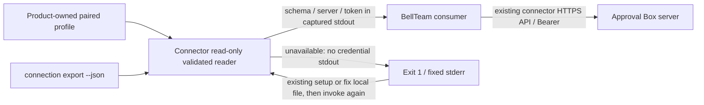

# Local connection export contract

Public interface since connector 0.1.35: `approval-box connection export --json` (also `npx --yes approval-box@0.1.35 connection export --json`). This is a local CLI contract, not a published JavaScript module or a server endpoint.

## Stable executable and installation

The product-owned executable is `<profile>/bin/approval-box`; for the default BellTeam profile it is `/home/bell/.approval-box/bin/approval-box`. Invoke that executable with argv `connection export --json`. The launcher uses `node` from the caller PATH and imports the installed versioned CLI; callers never construct a `runtime/<version>` path.

`approval-box install-runtime` copies the current published bundle to its versioned runtime and atomically replaces the stable executable (mode 0755). It prints the stable path, performs no network request, and does not pair, change config/hooks or start a daemon. Normal `setup` uses the same installer, so each installed release refreshes the executable. `uninstall` removes the stable launcher while retaining the existing historical-runtime policy for old conversations. To bootstrap without an existing launcher, use `npx --yes approval-box@0.1.35 install-runtime`; subsequent releases can be installed through the same published command.

Installation flow: published package → existing product runtime copier → versioned CLI → atomic same-directory rename of the stable executable → consumer invocation. A failed launcher write preserves the prior executable and cleans only its own temporary file; the next install can regenerate it from the package. The contract protects against replacing an existing executable with a partial file.

## Function contract

| Owner / function | Input | Output / caller | Failure and next transition |
| --- | --- | --- | --- |
| Connector CLI `connection export --json` | Explicit command; existing paired profile selected through the public `APPROVAL_BOX_HOME` setting, or the default home | Exactly one JSON object and newline on stdout: `{ "schema": "approval-box.connection.v1", "server": "https://approval-box.kitepon.dev", "token": "<connection bearer>" }` | Invalid command returns exit 1, empty stdout and a usage error on stderr; correct command can be invoked again |
| Product `connection-export.ts` | Product-owned local config, opened read-only with no symlink following; no caller-owned filesystem layout | Validated public `server` and exact `token` values only; extra private config fields are not exported | Missing, malformed or unsafe config returns exit 1 with `APPROVAL_BOX_CONNECTION_UNAVAILABLE`, empty stdout and no token/path/content in stderr; correcting the file or completing the existing setup makes the next invocation succeed |
| BellTeam usage/auth consumer (Mika, bd02) | Captured CLI stdout from its same-user product installation | Validate schema and expected official server; retain existing registered connection/user and remote authorization checks | Nonzero exit or invalid result remains unavailable under BellTeam's existing semantics; it must not fall back to a private config read |

The exporter has no network access, pairing, credential refresh, writes, daemon startup or revocation. It does not validate remote ownership or mint a new credential. No caching or credential file is created. It exports a secret intentionally: callers capture stdout in a private pipe and do not log it or place it in command-line arguments. The explicit `--json` command prevents accidental credential output through the ordinary status/help command.

## Data flow and state ownership

Private path, storage format and filesystem validation remain Approval Box's responsibility. The reader checks realpath equality, a regular single-link file, 1..65536 bytes, POSIX current UID/GID and exact mode 0600 where UID/GID exist. It bounds the read on one descriptor, checks size/mtime/ctime again, and clears its byte buffer. On platforms without POSIX UID/GID, the regular-file/link/size/race checks remain; filesystem access control is provided by the platform. This preserves the prior Linux consumer's file protections without requiring BellTeam to know a private path.

Validate JSON before emitting any credential. Server is a nonempty HTTP(S) URL without userinfo, surrounding whitespace or CR/LF, with one trailing slash removed; token is a nonblank string without CR/LF. No token trimming is performed. Errors never include the offending value. `server` is an API base URL; consumers continue to apply their own expected-server/identity policy.

There are no automatic writes or retry loops. Correction/setup is an existing state transition rather than a new approval gate. No state is transferred between products except through the CLI output and the existing authenticated HTTP contract.

## Verification scope

Use synthetic profiles only. Exercise the public source/built CLI and package bundle: exact output/schema/minimal fields, no network/state changes, unavailable config, malformed config/value, permission/link rejection, and an empty stdout without leaked synthetic token for errors. POSIX-only ownership/mode/link cases are conditional on the platform. Existing server/API/native behavior is outside this additive local interface change.
