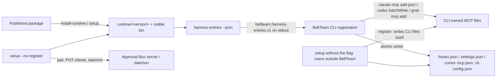

# Harness entries for a single host writer (since 0.1.37)

Public interface: `approval-box harness-entries --json`, invoked through the stable executable (`<profile>/bin/approval-box`, `/home/bell/.approval-box/bin/approval-box` for BellTeam). Consumer contract: BellTeam `docs/architecture/modules/runtime/cli-registration.md`, "One writer per CLI file" (bd14, PR kitepon/BellTeam#1396), schema `bellteam.harness-entries.v1`, shape "E1 v1.1" (PR head 35c8bc23): native entries per harness, verbatim.

It prints the MCP server, hooks and Cursor tool permissions that `setup`/`register` write today, so a host that owns the CLI files (BellTeam) can write them instead. `setup --no-register` then keeps pairing, runtime install, client report and daemon, and writes no CLI file.

## Function contract

| Owner / function | Input | Output / caller | Failure and next transition |
| --- | --- | --- | --- |
| CLI `harness-entries --json` | Explicit argv; the installed versioned runtime it runs from | One JSON object and newline on stdout, exit 0. Reads no config, state or credential; no network; writes nothing | Wrong argv: exit 1, usage on stderr. Not running from `<profile>/runtime/<version>` (npx cache, source tree): exit 1 `APPROVAL_BOX_RUNTIME_NOT_INSTALLED`, empty stdout, because the printed paths would vanish with the cache (protection: registering a wrong target). `install-runtime` then invoking the stable executable succeeds |
| `harness.ts harnessEntries()` | `registration()`, steer `claudeParentHookEntries` / `cursorParentHookCommand`, `CURSOR_TOOLS`, `CODEX_ENV_VARS`, `HOOK_FILES` | The native values `registerTools()` writes, per harness | Pure; shares every builder with `register`, so the two cannot drift |
| CLI `setup --no-register` | Same as `setup` | Runtime install, pairing/config, `register` with no targets (only the daemon start), `PUT /connection/clients` | Same failures as `setup`; no CLI file is read or written |
| BellTeam CLI registration (Molly, bd14) | Captured stdout | Writes MCP through each CLI's public command, hooks/permissions through its atomic writer, merged by product | Missing/invalid output keeps that product's last good entries (BellTeam-owned) |

Output (paths from the runtime that prints them; `<node>` is the stable node executable; mcp-lazy wrapping is BellTeam's transform step, so the entry is raw):

```json
{"schema":"bellteam.harness-entries.v1","product":"approval-box","version":"0.1.37",
 "mcpServers":{"approval-box":{
   "claude":{"type":"stdio","command":"<node>","args":["<runtime>/cli.mjs","mcp"]},
   "codex":{"command":"<node>","args":["<runtime>/cli.mjs","mcp"],"env_vars":["CODEX_HOME"]},
   "cursor":{"command":"<node>","args":["<runtime>/cli.mjs","mcp"]},
   "grok":{"command":"<node>","args":["<runtime>/cli.mjs","mcp"]}}},
 "hooks":{
  "claude":{"PreToolUse":[{"matcher":"^mcp__approval-box__(request_decision|setup_test|amend_decision|resume_decision)$","hooks":[{"type":"command","command":"exec '<node>' '<runtime>/approval-box-claude-hook.mjs'","timeout":15}]}],
            "PostToolUse":[{"matcher":"<same>","hooks":[{"type":"command","command":"<same>","asyncRewake":true,"timeout":86400}]}],
            "Stop":[{"hooks":[{"…asyncRewake":true,"timeout":86400}]}],
            "SessionStart":[{"hooks":[{"…asyncRewake":true,"timeout":86400}]}],
            "SessionEnd":[{"hooks":[{"…timeout":15}]}]},
  "cursor":{"afterMCPExecution":[{"command":"'<node>' '<runtime>/approval-box-cursor-hook.mjs'","timeout":15}],
            "postToolUse":[{"command":"<same>","timeout":15}]}},
 "permissions":{"cursor":{"allow":["Mcp(approval-box:list_my_decisions)","…","Mcp(approval-box:confirm_setup_test)"]}},
 "owns":{"commandIncludes":["approval-box-claude-hook.mjs","approval-box-cursor-hook.mjs"]}}
```

Every value is the one `register` writes: Claude MCP and hooks (`mergeClaudeParentHooks`), Codex `mcp_servers.approval-box` (`config/batchWrite`; `env_vars` are names, the seat supplies `CODEX_HOME`), Cursor `mcp.json`, hooks (`mergeCursorParentHooks`) and `cli-config.json` `permissions.allow`, Grok `grok mcp add` with command/args. No Codex or Grok hooks (Codex answers go through Aiterm's shared Steer), no settings. `owns.commandIncludes` lets the host recognise hooks an older version wrote from another `runtime/<version>`. Instruction files are not part of E1 (BellTeam's rules carry the sentence; `--no-instructions`). No secret is read or printed.

## Data flow



Switchover (BellTeam contract steps 1-3): (1) this release publishes E1; (2) BellTeam lists the product and applies it with identical results; (3) only after Molly's one "applied" message the BellTeam seat's `environment/setup.sh` adds `--no-register`. Until step 3 the seat setup keeps writing as today. Ordinary users keep `setup` with registration.

## Verification scope

Synthetic homes only: E1 equals what `register` writes for Claude and Cursor (same builders; Codex `env_vars` and Grok args share the constants), no credential or config is read, argv/runtime errors leave stdout empty, `setup --no-register` passes no target to `register`. The bundle check runs the stable executable from a temporary installed runtime. Real seat files are BellTeam's step 2.
