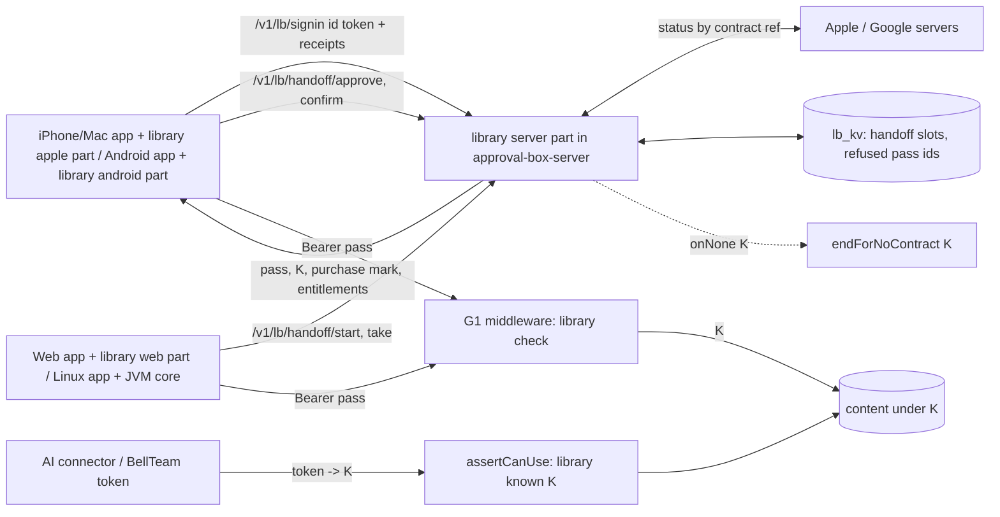

# Approval Box login and billing with the shared library (adoption order, phases A-C)

Owner: Nayuta (bot-4366a50b). Status: adoption plan, 2026-11-20, chart login-billing/baseline-20261120/t13-ab-plan. The mechanism is the shared login & billing library ([contract v1](/srv/bellteam/bots/bot-137fd092/docs/login-billing/library-contract.md), builder Prim, owner Mint) implementing [design-qr-pass.md](/srv/bellteam/bots/bot-137fd092/docs/login-billing/design-qr-pass.md) and the Owner's baseline (App Store + Google Play only, Apple + Google sign-in only, no linking, Stripe abolished, pass 14 days sliding, stopping one device, no QR login before a contract). Approval Box builds none of the mechanism itself; it mounts the library and keeps its product content under K. This page replaces the in-product design of PR #46.

## Functions (what Approval Box owns vs. the library)

| Function | Owner | Input -> output | Failure / exit |
| --- | --- | --- | --- |
| Sign-in, K, receipts, store asking, pass issue/check/renew, QR handoff, refused passes, per-K memory | library server part, mounted by http.ts under `/v1/lb/` | library wire contract v1 | library error codes (signin_invalid, pass_*, no_entitlement, slot_gone ...) |
| Library configuration | server main.ts | signIn client ids (existing APPLE_AUDIENCES, GOOGLE_CLIENT_IDS); stores: Apple { bundle dev.kitepon.approvalbox, app Apple id, API key ref }, Google { package dev.kitepon.approvalbox, service account ref }; products [{dev.kitepon.approvalbox.monthly, apple, subscription}, {dev.kitepon.approvalbox.monthly, google, subscription}]; kKey, passKeys, exemptK = the Owner's K; billing "store" (BILLING=off servers pass "off") | missing key -> the server does not start in library mode (named error) |
| Storage for the library | server lb-storage.ts on SQLite table `lb_kv(key, value, expires_at)` | put/get/delete with expiry, only handoff slots and refused pass ids | expired rows swept with the existing sweep; survives restarts so a stopped device stays stopped |
| Device gate (G1) | http.ts v1 middleware | Bearer pass -> library check -> K, entitlements, renewedPass (sent back in `X-Approval-Box-Pass`). Paid routes need a live monthly entitlement or exempt K: decision list/get/answer/hold/delete, attachments, SSE | 402 `subscription_expired`. Always open: /me, settings, devices, pairing lookup/claim/reject, setup-test decisions (setup_test stays outside both gates) |
| Non-device gate (G2) | accounts.ts assertCanUse for connection tokens and BellTeam client tokens | library `known(K)`: none -> 402; active or unknown -> accepted | as today's 402 |
| End waiting AI requests | decisions.ts `endForNoContract(K)` registered with library `onNone` | pending/held AI decisions of K end as cancelled, cancel_reason `subscription_expired` | setup-test decisions are not ended |
| /me | accounts.ts | user_id = K, plan active/expired from the pass's entitlements (device) or known(K); store from the entitlement; purchase mark from the library | unchanged shape |
| Product content | db.ts | users, decisions, history, attachments, request_uploads, connections, pairings, devices, setup_checks, idempotency, events keyed by K | unchanged |
| AI pairing approval | existing /v1/pairing/* | approved from the phone or Mac app with a pass (no entitlement needed) | unchanged |

## Data flow

## Adoption order

- **A. Server, compatible (Nayuta).** Precondition: library accepted (t12) and pinned by version + checksum; K-key, pass-keys, Apple In-App Purchase key in the host vault (Sakura). Steps, diagrams first in the same diff: mount the library; lb_kv storage; G1 for pass requests; G2 via known(K); onNone -> endForNoContract; rekey migration (K for every identities row computed with the library's own K function, user_id replaced by K in every content table; the 8 identity-less test accounts deleted under Mint's run-time check, stop and change nothing if it fails; exempt list switched to the Owner's K in the same deploy). Old sessions, /v1/auth/*, browser login and the subscription tables keep working so current app versions keep running.
- **B. Apps.** iPhone/Mac (Redshoes): library apple part (sign-in, StoreKit purchase with the mark, receipt, Keychain pass, QR scan and short code approve with Approval Box's confirm screen, linked devices and stop) plus an AI pairing approval screen on Mac. Android and Linux (Indibiria): library android part and JVM core; Apple sign-in on Android becomes QR login from an iPhone; Linux shows the QR or short code and 「先にスマホで契約してください」 when approval is refused. Web (Nayuta): library web part, QR and check number, no Apple/Google buttons. Store releases are the Owner's decision. The sandbox acceptance run (t15-ab-accept) happens here.
- **C. Server removal (Nayuta).** After the Owner's devices and the minimum supported versions use passes: remove sessions, identities, auth_flows, login_links, /v1/auth/*, browser login, appstore.ts, play.ts and their tables and store notification endpoints (the library asks the stores).

## Requests to the library (for Mint/Prim)
- Export the K function so the rekey migration computes the same K as signIn.
- K and the Apple purchase mark as UUIDs, so existing columns and appAccountToken keep their type.

## Not changed
- Connection tokens and BellTeam client tokens stay valid; only their owner key becomes K. Nobody pairs again.
- Diagnostics stay unlinked to accounts.
- Account deletion deletes content under K; store contracts are cancelled by the user in the store.
