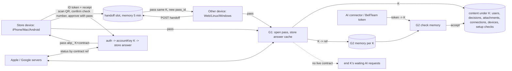

# Approval Box login and billing with device passes (design, phases A-C)

Owner: Nayuta (bot-4366a50b). Status: design for review, 2026-11-20. Implements Mint's cross-product contract [design-qr-pass.md v1](/srv/bellteam/bots/bot-137fd092/docs/login-billing/design-qr-pass.md) (Owner decisions 2026-11-20: Stripe abolished; App Store + Google Play only; Apple + Google sign-in only; no account linking; pass lifetime 14 days sliding; stopping one device adopted; no QR login before a contract). This page is the Approval Box function and data-flow diagram for the change; code follows it. Contract details go to [api.md](../api.md) in the same diff as each phase.

## Functions (who owns what)

| Function | Owner in code | Input -> output | Failure / exit |
| --- | --- | --- | --- |
| Account key K | server identity.ts `accountKey(provider, subject)` | HMAC-SHA256(K-key, provider:subject) -> UUID (16 bytes, v4/variant bits set). Replaces user_id everywhere; never stored next to provider/subject | K-key missing -> server does not start in pass mode (named error; losing K-key would orphan content) |
| Pass | server pass.ts `seal/open` | AES-256-GCM with pass-key over {k, contract: {store, id} or null, pass_id, label, issued_at, renewed_at} -> opaque `abp_...` bearer | bad tag / unused > 14 days / refused pass_id -> 401 `unauthorized` (device signs in again or scans a new QR) |
| Sliding renewal | pass.ts | pass older than 1 day on any request -> response header `X-Approval-Box-Pass` with a renewed pass | device keeps the old pass if it misses the header (still valid until 14 days unused) |
| Sign-in | http.ts `/v1/auth/apple`, `/v1/auth/google` | native ID token (+ nonce) and optional receipt (Apple signed transaction / Play purchase token) -> `{ pass, user: { id: K } }`. Phase A also returns the old `session` | invalid token -> 401; receipt whose store mark is not K -> 409 `conflict` |
| Store answer | store.ts `contractState(ref)` using appstore.ts (Get All Subscription Statuses, t16) and play.ts (subscriptionsv2.get) | contract ref -> {alive, until} cached in memory 10 min per ref | store unreachable -> last cached answer; none -> treated as alive and asked again next request (design 4.4) |
| G1 device gate | http.ts v1 middleware | pass -> contract alive or K exempt -> paid routes (decision list/get/answer/hold/delete, attachments, SSE) | 402 `subscription_expired`. Always open: /me, settings, devices, pairing lookup/claim/reject, setup-test decisions (setup_test stays outside the gates), pass handoff, refuse |
| G2 memory | store.ts `latestByK` (memory) | each device request records K -> contract ref or none | non-device request (connection token, BellTeam client token) for K: memory none/dead -> 402; no memory (after restart) -> accepted |
| End waiting AI requests | decisions.ts `endForNoContract(K)` | a device request shows K has no live contract -> K's pending/held AI decisions end as cancelled with cancel_reason `subscription_expired`, delivered through the normal wait | setup-test decisions are not ended |
| QR handoff | pass.ts `HandoffSlots` (memory, 5 min) | other device: POST /v1/pass/handoff {label} -> {slot_id, check (2 digits), expires_at}; GET /v1/pass/handoff/:slot (poll) -> pass once. Phone: GET /v1/pass/handoff/:slot/info -> {label, check}; POST /v1/pass/handoff/:slot/approve with its pass | approve needs a live contract (or exempt K) -> else 402 and the other device shows 「先にスマホで契約してください」; slot gone -> 404 |
| Stop one device | pass.ts `refuse`, table `refused_passes(pass_id, until)` | phone: POST /v1/pass/refuse {pass_id} with its pass (same K) | row deleted when until passes |
| AI connection pairing on the phone | existing /v1/pairing/lookup, claim, reject | unchanged API; must be usable from iPhone, Mac and Android apps (no contract needed: setup_test comes before buying) | unchanged |
| Exempt accounts | FREE_ACCOUNT_IDS | list of K values (the Owner's K computed before the rekey deploy) | unchanged meaning |

## Data flow

The server keeps no login or billing row: no identities, no sessions (after phase C), no subscription tables. Durable login-related state is only K-key/pass-key (vault) and refused pass ids until they would expire anyway.

## Phases

- **A. Server, compatible (Nayuta, t21a-server).** Migration: compute K for every identities row and rekey user_id in users, decisions, history, attachments, request_uploads, connections, pairings, devices, setup_checks, idempotency, events; delete the 8 identity-less test accounts of 2026-10-01 (Mint, 2026-11-20). At the moment it runs the migration checks that the identity-less users are exactly those 8 and that each still has no identity, 0 requests, 0 devices and no store purchase; if any check fails it stops and changes nothing (no delete, no rekey). The deploy record states the number deleted. Switch FREE_ACCOUNT_IDS to the Owner's K in the same deploy. Add pass, sign-in with receipt, handoff, refuse, G1/G2, endForNoContract. Old sessions, browser login and subscription tables keep working for current app versions; G1 applies to pass requests, the existing plan check stays for session requests.
- **B. Apps.** iPhone/Mac (Redshoes): sign-in sends the StoreKit receipt, keep the pass in Keychain, send it as Bearer, take renewed passes, scan/approve handoff showing label + check number, device list with stop, AI pairing approval on Mac (iPhone already has PairingView). Android (Indibiria): native Google sign-in instead of Custom Tabs, Play receipt at sign-in, pass, scan/approve, device list, pairing approval. Linux (Indibiria) and Web (Nayuta): show QR + check number, poll, 「先にスマホで契約してください」, no Apple/Google browser login. appAccountToken / obfuscatedAccountId = /me user_id (= K after phase A), unchanged code path.
- **C. Server removal (Nayuta).** After the Owner's devices and the minimum supported versions use passes: remove sessions, identities, auth_flows, login_links, browser login, store subscription tables and store notification endpoints, Stripe leftovers.

## Not changed
- Connection tokens and BellTeam client tokens stay valid (only their owner key becomes K). Nobody pairs again.
- Diagnostics stay unlinked to accounts.
- Account deletion deletes content under K; store contracts are cancelled by the user in the store.
