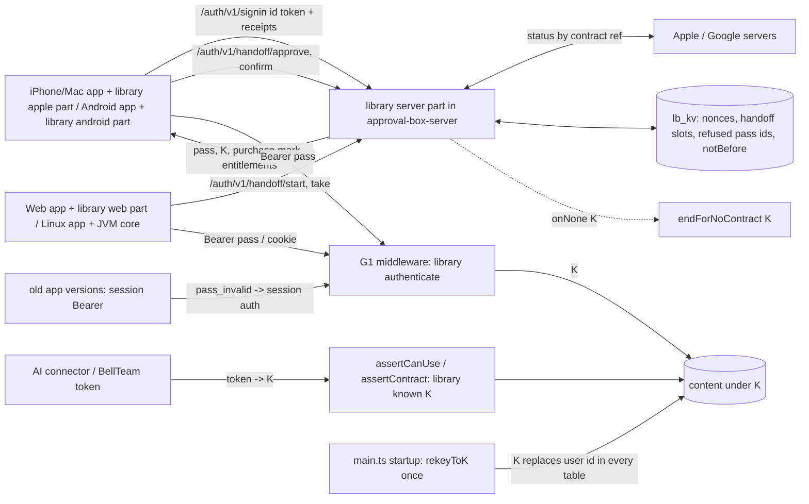

# Approval Box login and billing with the shared library (adoption order, phases A-C)

Owner: Nayuta (bot-4366a50b). Status: adoption plan, 2026-11-20, chart login-billing/baseline-20261120/t13-ab-plan; phase A (server, compatible) implemented on branch feat/library-adoption-a-20261120 (code: packages/server/src/lb.ts, rekey.ts, export.ts; vendored library vendor/kitepon-login-billing-0.2.1.tgz). The mechanism is the shared login & billing library ([contract v1](/srv/bellteam/bots/bot-137fd092/docs/login-billing/library-contract.md), builder Prim, owner Mint) implementing [design-qr-pass.md](/srv/bellteam/bots/bot-137fd092/docs/login-billing/design-qr-pass.md) and the Owner's baseline (App Store + Google Play only, Apple + Google sign-in only, no linking, Stripe abolished, pass 14 days sliding, stopping one device, no QR login before a contract). Approval Box builds none of the mechanism itself; it mounts the library and keeps its product content under K. This page replaces the in-product design of PR #46.

## Functions (what Approval Box owns vs. the library)

| Function | Owner | Input -> output | Failure / exit |
| --- | --- | --- | --- |
| Sign-in, K, receipts, store asking, pass issue/check/renew, QR handoff, refused passes, per-K memory | library server part, mounted by http.ts under `/auth/v1` (lb.ts `createLibrary`; allowed origin = PUBLIC_URL, cookie defaults) | library wire contract v1 | library error codes (signin_invalid, pass_*, no_entitlement, slot_gone ...) |
| Library configuration | server main.ts (read like the existing secrets, `*_FILE` through start-with-secrets.sh) | library mode is on only when `LB_K_KEY` (base64url, 32+ bytes), `LB_PASS_KEY` (base64url, 32 bytes) and `LB_PASS_KEY_ID` are all set (`LB_PASS_KEY_PREVIOUS` + `_ID` while rotating). signIn client ids: existing APPLE_AUDIENCES, GOOGLE_CLIENT_IDS (+ web ids); stores: Apple { bundleId APPSTORE_BUNDLE_ID, issuerId/keyId/privateKey APPSTORE_ISSUER_ID/KEY_ID/PRIVATE_KEY } and Google { package PLAY_PACKAGE_NAME, service account PLAY_CLIENT_EMAIL/PLAY_PRIVATE_KEY }, each only when its keys are set (library 0.2.1 needs no Apple app id); products [{dev.kitepon.approvalbox.monthly, apple, subscription}, {dev.kitepon.approvalbox.monthly, google, subscription}]; exemptK = FREE_ACCOUNT_IDS read as K values; billing "store", or "off" when BILLING=off | no keys at all -> one startup line "library mode off", behaviour exactly as before; some keys missing or malformed -> one named line, library mode off |
| Storage for the library | server lb.ts `SqliteStorage` on SQLite table `lb_kv(key text primary key, value text not null, expires_at integer not null)` (migration 16) | put/get/delete with expiry: nonces, handoff slots, refused pass ids, notBefore records. Reads ignore expired rows | expired rows removed by the hourly sweep in main.ts; survives restarts so a stopped device stays stopped. signin/nonce (60/min) and handoff/start (20/min) are rate-limited per client in memory (the last X-Forwarded-For hop, else the socket address; never logged or stored) -> 429 `rate_limited` |
| Device gate (G1) | http.ts v1 middleware | the library's `authenticate` first (Bearer pass or cookie `lb_pass` + Origin) -> K (users row created if missing), kind, entitlements; a renewed pass goes back in `Login-Billing-Pass` (cookie: Set-Cookie). Anything that is not a pass (`pass_invalid`) falls back to the old session auth; other pass errors (`pass_expired`, `pass_refused`, `origin_refused`) answer with the library's code. Paid routes need a live `dev.kitepon.approvalbox.monthly` entitlement or exempt K: decision list/get/answer/hold/unhold/delete, attachments, `/v1/events` | 402 `subscription_expired`. Always open: /me, /me/settings, /me/export, DELETE /me, devices, connections, tokens, pairing lookup/claim/reject, billing/*, and a setup-test decision itself (`GET /decisions/{id}` and `POST /decisions/{id}/answer` when the decision is a setup check) |
| Non-device gate (G2) | accounts.ts `assertCanUse` (connection tokens: POST /connector/v1/decisions, /request-images, remote MCP) and `assertContract` (BellTeam client sessions on every allowed route except `GET /me`) | library `known(K)`: none -> 402; active -> accepted; unknown -> today's plan check (connection tokens) or accepted (client sessions, which have no plan check today) | 402 `subscription_expired` |
| End waiting AI requests | decisions.ts `endForNoContract(K)` registered in main.ts with library `onNone` | pending/held non-setup decisions of K end as cancelled, cancel_reason `subscription_expired`, through the normal `decision.updated` event (SSE/push); unbound answer drafts are removed | setup-test decisions are not ended |
| /me | accounts.ts `me(K, entitlements)` | user_id = K, plan "active" when a live entitlement for the monthly product or exempt K, else "expired"; store from the entitlement (apple -> app_store, google -> google_play, none for exempt); `expires_at` from the entitlement (not for exempt); `purchase_mark` = K. Without a pass the old fields are unchanged | unchanged shape plus purchase_mark |
| Rekey to K (one-time, deploy) | rekey.ts `rekeyToK`, called in main.ts after the library is created, before serving | every `identities` row -> K = library deriveK(provider, subject) (same function as sign-in); K replaces the user id in users.id and in every column that holds it (user_id, link_user_id, any other foreign key to users; found from the schema); the identity-less test accounts in `LB_REKEY_DELETE_IDS` (comma list, supplied at deploy) are deleted with their content. Done mark: `lb_kv` row `rekey:done` with no expiry | preconditions, checked inside one transaction before any change: (a) every other user has exactly one identities row; (b) the identity-less users are exactly the delete list and each has 0 decisions, devices and setup checks and no subscription row; (c) no appstore/play subscription row is live. Any failure (or any error) rolls back, logs one line with the check name only (identities, delete_set, delete_set_content, live_subscription, error), and the server runs in compatible mode: library mode off (the library is not mounted, so no empty K account can fork from an old account). Success logs the numbers deleted and rekeyed only |
| Old sign-in in library mode | accounts.ts `signInWithIdentity(provider, subject, K)` | /v1/auth/apple|google and the browser callbacks create a new account with id = deriveK(provider, subject), so the old and the new login land on the same account (a users row made earlier by a pass is reused) | unchanged |
| Product content | db.ts | users, decisions, history, attachments, request_uploads, connections, pairings, devices, setup_checks, idempotency, events keyed by K | unchanged |
| Copy of what is kept (adoption condition, Mint/Poli 2026-11-20) | http.ts `GET /v1/me/export` (any signed-in device: pass or old session, no entitlement needed; not connection tokens, not BellTeam client sessions), export.ts `exportAccount` | everything kept under K as one JSON file download (`Content-Disposition: attachment; filename="approval-box-export-YYYYMMDD.json"`) the person fetches self-service from the account section of Settings in the signed-in app (finishes automatically; no request form the operator receives or answers; Owner ruling via Poli 2026-11-20): `account` (settings, plan fields), `decisions` (API form with history and answers), `attachments` (metadata + content as base64; includes request files and unbound drafts; `data_base64` null when the file is missing), `connections` (label, kind, os, clients, created/last seen; no token hashes), `devices` (platform, locale, created/updated; no push tokens), `setup_checks` (no confirmation code). Not included: sessions, pairings, identities, idempotency records, events, staged request uploads | nothing is answered by e-mail or on the account number alone; an export never includes other accounts or secrets |
| Web: which login | server `GET /v1/auth/config` (public) + web `loginConfig` | adds the boolean `library_login` (true only when the library is mounted; false otherwise and on old servers, where the field is absent) -> the Web shows the library login only when it is true; when false/absent it keeps the Apple and Google buttons and the session in localStorage exactly as before | config unreachable -> treated as false |
| Web: library login screen | packages/web `librarylogin.tsx` (library web part, public entry `@kitepon/login-billing/web` only, vendored tgz 0.2.1) | `createWebClient({ baseUrl: <origin>/auth/v1, carrier: "cookie" })` (the library's baseUrl is the mounted prefix, not the bare origin); `startLogin(deviceLabel)` with a label built from the user agent ("Chrome on Windows"; browser and OS family only, no personal data) -> `qrSvg(qrPayload)`, short code XXXX-XXXX, check number; text 「スマホの決裁箱アプリで読み取るか、コードを入力してください。表示される番号が {checkNumber} か確かめてください。」 and 「契約がまだの方は、先にスマホで契約してください。」; `waitForPass()` -> the cookie `lb_pass` is set by the server and the app continues. The pass is HttpOnly: the Web never reads it and keeps no copy | `slot_gone` (expired) -> 「新しいコードを出す」 starts a new handoff; any other error -> a message and the same button; leaving the screen aborts the wait |
| Web: API calls in library mode | packages/web `api.ts` | no `Authorization` header; the browser sends the cookie on same-origin requests (credentials same-origin, the fetch default). Library error bodies `{ error: "<code>" }` are read as codes. On start the Web probes `GET /v1/me` (open without a contract) to learn whether a pass cookie is already valid | 401 (any `pass_*`, or no pass) -> back to the login screen; 402 `subscription_expired` -> 「iPhone・Mac・Android のアプリで契約してください」 where the content would be (settings, /me, export and delete stay reachable) |
| Web: account section of Settings | packages/web `Settings.tsx`, `api.ts` `downloadExport` | 「保存されている情報の写しを受け取る」 fetches `GET /v1/me/export` and saves the JSON file (name from Content-Disposition); no form, finishes by itself. Account deletion is kept. With library login, the sign-out button calls the library `signOut()` (refuses this device's pass and clears the cookie) instead of `POST /auth/logout` | export or sign-out failure -> a message, the screen stays signed in (sign-out can be retried: the library keeps the pass when the call did not reach the server) |
| Logs | all of packages/server/src | no console output carries a user id, K, e-mail or address. The admin command that printed a session for a user id is removed | - |
| Account deletion | existing `DELETE /me` | deletes everything kept under K (already in the app) | unchanged |
| AI pairing approval | existing /v1/pairing/* | approved from the phone or Mac app with a pass (no entitlement needed) | unchanged |

## Data flow

## Adoption order

- **A. Server, compatible (Nayuta; built, see Status).** Precondition: library accepted (t12) and pinned by version + checksum; K-key, pass-keys, Apple In-App Purchase key in the host vault (Sakura). Steps, diagrams first in the same diff: mount the library; lb_kv storage; G1 for pass requests; G2 via known(K); onNone -> endForNoContract; rekey migration (K for every identities row computed with the library's own K function, user_id replaced by K in every content table; the 8 identity-less test accounts deleted under Mint's run-time check, stop and change nothing if it fails; exempt list switched to the Owner's K in the same deploy). Old sessions, /v1/auth/*, browser login and the subscription tables keep working so current app versions keep running.
- **Logs and legal pages (A).** No account number (K or old user id) in Approval Box's own logs; the admin command that prints a session for a user id is removed in A. The annex privacy/terms pages change on the switch day, from Poli's draft (login-billing t17-privacy-draft).
- **B. Apps.** iPhone/Mac (Redshoes): library apple part (sign-in, StoreKit purchase with the mark, receipt, Keychain pass, QR scan and short code approve with Approval Box's confirm screen, linked devices and stop) plus an AI pairing approval screen on Mac. Android and Linux (Indibiria): library android part and JVM core; Apple sign-in on Android becomes QR login from an iPhone; Linux shows the QR or short code and 「先にスマホで契約してください」 when approval is refused. Web (Nayuta; built on feat/library-web-20261120, shown only when `/v1/auth/config` says `library_login`, so old servers and production keep the Apple/Google buttons until the switch): library web part, QR and check number, no Apple/Google buttons. Every app offers 「保存されている情報の写しを受け取る」 (the export above) next to account deletion in Settings. Store releases are the Owner's decision. The sandbox acceptance run (t15-ab-accept) happens here.
- **C. Server removal (Nayuta).** After the Owner's devices and the minimum supported versions use passes: remove sessions, identities, auth_flows, login_links, /v1/auth/*, browser login, appstore.ts, play.ts and their tables and store notification endpoints (the library asks the stores).

## Requests to the library (for Mint/Prim)
- Done in 0.2.1: the K function is exported (`deriveKWith`, and `lb.deriveK`), and K and the purchase mark are lowercase UUIDs.
- Not offered by 0.2.1 and not needed in phase A: the library exports no test helpers (src/testing is not in the package), so Approval Box's tests drive the public API with a fake fetch.

## Contract 1.5 / library 0.2.1 details for Approval Box (t14, 2026-11-20)

- Pinned: library 0.4.0 (contract 1.8), npm tgz sha256 988c522838594992741fc74a135dd60a73941e2f3983928c55deb4c4a14b496d (server + web; 0.2.1 before 2026-11-20 12:30 JST), core jar 155a5550662171b78f289d3e784081184d2570a3e86158bb829869cfadecdb89, android aar b43467757a39bccd4f8ab69b7e6fc7a58bccbfb9016c61b63d859c6f8ac997d4, Swift package tag v0.2.1 (release https://github.com/kitepon/login-billing/releases/tag/v0.2.1). Used unchanged; a need or bug goes to Mint as one message.
- Mount: the library handler at `/auth/v1` (wire v1: signin/nonce, signin, receipt, handoff/start|approve|confirm|take, refuse, stop-all-others, signout). Product routes `/v1/*` use the handler's authenticate(request): Bearer for apps and the Linux client, cookie `lb_pass` with allowed origin https://approval-box.kitepon.dev for the Web. A renewed pass comes back in `Login-Billing-Pass`.
- Pass kinds: only a phone's (store) pass may attach receipts, approve a QR, refuse, stop all others. Web/Linux hold handoff passes.
- Storage: SQLite `lb_kv(key, value, expires_at)` behind the library Storage interface for nonces, handoff slots, refused pass ids and notBefore records; signin/nonce and handoff/start rate-limited per client by Approval Box.
- Sign-in needs a server nonce (apps call signin/nonce first; Apple gets sha256hex(nonce)). Receipts never fail a sign-in (per-receipt results).
- Apps call start() at launch and on foreground; signOut clears the device; stopAllOthers for a lost phone.
- Test environment: a second server `approval-box-test` on main-server with its own database and keys, at https://approval-box-test.kitepon.dev, App Store sandbox and Play internal track. t14 closes when the server and every app run there.
- Google id-only test preparation (README list): dedicated Google Cloud OAuth web client (consent scope openid only) + Android OAuth client in the same project; web client secret through Sakura into signIn.googleCode; Android switch for the id-only route; two test Google accounts (fresh, and one that granted e-mail first).

## Not changed
- Connection tokens and BellTeam client tokens stay valid; only their owner key becomes K. Nobody pairs again.
- Diagnostics stay unlinked to accounts.
- Account deletion deletes content under K; store contracts are cancelled by the user in the store.

- Google id-only route (test server only): LB_GOOGLE_CODE_CLIENT_ID and LB_GOOGLE_CODE_CLIENT_SECRET (Cielo's dedicated project approval-box-id-only-test) turn on the library's signIn.googleCode; absent elsewhere.
