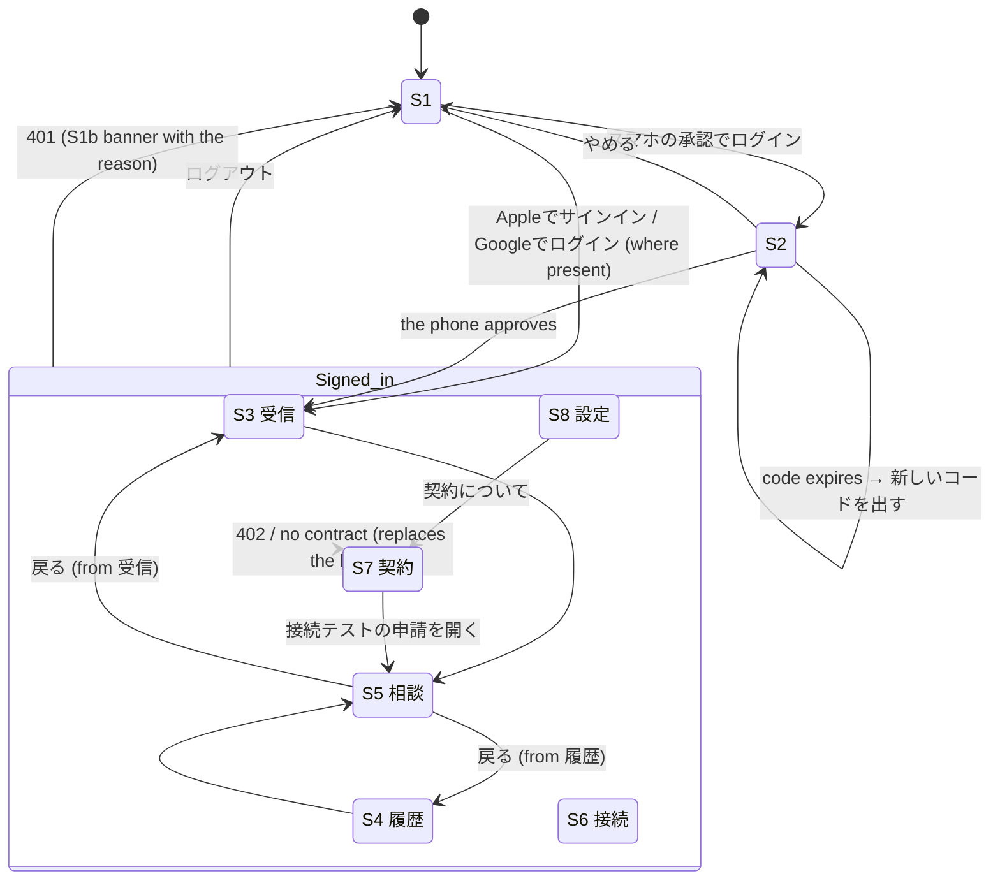

# Approval Box screens: the one state machine every app implements

Status: **approved by the Owner on 2026-11-21** (Approval Box K-5V9T4F: go ahead, and the production switch waits for the redesign). Until each app implements it, the app keeps its current screens, which the per-app maps describe:
- Web: `docs/screen-transitions-web.md` (this repo)
- Apple: `docs/screen-transitions-apple.md` (approval-box-apps)
- Android and Linux: `docs/screen-transitions-android.md` and `docs/screen-transitions-linux.md` (approval-box-apps, PR #48)

Owner requirements (2026-11-21):
- From login onward the apps confuse. The menus are hard to follow, and nobody can find where to pay.
- Every platform must have the **same state transitions and the same guidance**.

This file is the single source of the screens: states, operations, labels and guidance texts. The iPhone, iPad, Mac, Android, Linux and Web apps implement it as written. Each app's own map shows how it implements this file and nothing more.

## 0. What may differ between apps (and nothing else)

| May differ | Why | How it still looks the same |
|---|---|---|
| The container: tab bar on a phone, sidebar on iPad, Mac, Linux and a wide browser | platform convention | the same 4 items, same order, same labels |
| The native sign-in button: Apple's system button (`Appleでサインイン`, text fixed by Apple's HIG) on iPhone/iPad/Mac, Google's branded `Googleでログイン` on Android, none on Linux/Web (ruling 2026-11-21: the vendor's own button text wins) | login-billing contract §3: the apple part signs in with Apple only, the android part with Google only, every other device is logged in by a phone | the same screen; the button is simply absent where the contract has none |
| Whether this device can buy | contract §3: only a device signed in with its own store (a store pass) can buy; a device logged in by a phone (handoff pass), Linux and Web cannot | the same screen `契約` with the same wording; the buy block is replaced by the same "where to buy" text |
| QR scanning | the Mac and Linux have no camera scanner | the code field is always there; the QR button is added where a camera exists |
| Keyboard shortcuts | desktop convention | optional extras, never the only way |

Everything else is the same everywhere: screen names, headings, button labels, section order, guidance texts, error texts, confirmations.

## 1. Words (one name per thing)

| Thing | The one label | Replaces |
|---|---|---|
| Pending and held requests | `受信` (menu item and page heading) | Web heading `Approval Box` |
| Answered and withdrawn requests | `履歴` | Web `既決` |
| AI and PC connections | `接続` (its own menu item everywhere) | Mac `設定・接続` |
| Settings | `設定` | |
| The paid plan | `契約` (section, screen and button `契約について`) | `プラン`, `Approval Boxの契約`, `契約・購入を確認` |
| Sign in with this device's own account | the vendor's own button: `Appleでサインイン` / `Googleでログイン` | |
| Log this device in by a phone's approval | `スマホの承認でログイン` | `別のスマホでログイン`, `スマホでログイン` |
| Approve another device's login (on a store phone) | `ほかの端末をログインさせる` | `QRコードまたはコードでログインさせる`, `別の端末のログインを許可` |
| Devices this phone logged in | `ログインさせた端末` | |
| Add a PC/AI | `AIをつなぐ` | `端末を追加` (it collided with device login) |

## 2. Menu (signed in)

Always 4 items, in this order: `受信` (with the pending count), `履歴`, `接続`, `設定`. The page heading equals the menu label. The highlight follows the page you are on: a request opened from `履歴` highlights `履歴`.

## 3. States

### S1 `ログイン` (signed out)
In this order:
1. `Approval Box` / `AIの相談に、スマホやPCから答えます。`
2. The native button where the contract has one: Apple's `Appleでサインイン` or Google's `Googleでログイン`.
3. `スマホの承認でログイン`. This is the main button on Linux/Web, and the second button where a native sign-in exists.
4. Disclosure `はじめての方へ` (the same 3 steps everywhere, shown with the numbers `1.` `2.` `3.`):
   1. `iPhone・iPad・Mac または Android の決裁箱で、Apple または Google でログインし、設定 → 契約 から契約します。`
   2. `PCでコマンドを実行して、AIとつなぎます。` + command + `コマンドをコピー`
   3. `ほかの端末（Linux・ブラウザ・もう一方のスマホ）は、この画面の「スマホの承認でログイン」を押し、契約したスマホの 設定 → ほかの端末をログインさせる で承認します。`
5. Links `利用規約` `プライバシーポリシー` `サポート`, then the language picker `言語`.
- Banner (only after an automatic sign-out, see S1b): the reason in one line.
- Self-hosted server in ID-login mode (Web only, never production): Google's sign-in box and `Appleでサインイン` take the place of item 2, followed by `GoogleとAppleは別のアカウントになります。いつも同じ方でログインしてください。`.

Edges:
- the native button → store sign-in → `受信`. On cancel, stay. On failure, the S9 alert.
- `スマホの承認でログイン` → S2.

### S1b Signed out by the server (banner on S1)
- Pass stopped from the phone: `この端末のログインは、承認したスマホから止められました。もう一度ログインしてください。`
- Pass expired (14 days unused): `しばらく使われなかったため、ログインが切れました。もう一度ログインしてください。`
- Other 401: `ログインが切れました。もう一度ログインしてください。`
Mapping: library code `pass_refused` → stopped, `pass_expired` → expired, anything else (e.g. `pass_invalid`) → the generic text (codes: login-billing library-contract.md §2). Before the redesign all six apps dropped to sign-in silently.

### S2 `スマホの承認を待っています`
1. QR (where shown), `ログインコード` `ABCD-EFGH`, `確認番号` `NN`, `HH:MMまで有効`.
2. Guidance, the same everywhere: `契約したスマホの決裁箱で、設定 → ほかの端末をログインさせる を開き、このQRを読むか、コードを入力してください。確認番号が同じなら「許可する」を押します。`
3. Button `やめる`.

Edges:
- The phone approves → `受信`.
- `やめる` → S1.
- The code expires → stay on S2; the QR, the code, the check number and the validity line are removed, and only `コードの期限が切れました。` and the button `新しいコードを出す` remain (with `やめる`); the guidance paragraph is removed too (ruling 2026-11-21 r2). No error dialog, no bounce to S1.
- A native sign-in finishes meanwhile → `受信` (the native sign-in wins, contract 1.11).

### S3 `受信` / S4 `履歴` (lists)
- In this order at the top of the list: the filter chips, then the search field `相談を検索`. No count line.
- The same filter chips everywhere: `受信`: `すべて` `未回答` `保留`; `履歴`: `すべて` `回答済み` `取り下げ`. Every row shows its status word, pending rows included, with the same words (`未回答`, `保留`, `回答済み`, `取り下げ`) (ruling 2026-11-21 r2). Next to the status word (never instead of it) a row shows `急ぎ` when the request is urgent and `修正あり` when the AI amended it (ruling 2026-11-21 r3).
- The same empty texts: `いま決めることはありません` / `相談が届いたら、お知らせします。` and `まだ履歴はありません` / `あなたの回答が、ここに残ります。`.
- No match for a filter or search: `この条件の相談はありません` (one line).
- A row opens S5. In a split view, the empty detail pane reads `相談を選んでください` (one line), and switching between `受信` and `履歴` clears the selection.
- When there is no contract, both lists are replaced by S7 (not a red line, not a dead end).

### S5 `相談` (one request)
Page heading `相談` on every app. Header, `背景`, `AIの添付画像`. When answerable, in this order:
1. `どう進める？` (options, `AIの推奨`)
2. `補足・別の指示`
3. One button `画像・書類を添付` (where the platform separates photos from files, the button opens a choice `写真` / `ファイル`), with the one hint line `最大10件・1件20MB・合計50MB` under it and no other hint (ruling 2026-11-21 r2; limits from the server's attachments.ts)
4. `保留する` / `保留を解除`
5. `回答を送信` (always this label; disabled until an option is chosen or text is written)
When answered: `あなたの回答`, delivery state, `再開の一言をコピー`. `戻る` returns to the list it came from (`閉じる` in a split view). After `回答を送信` the app stays on the answered request; it does not jump.

### S6 `接続` (AI and PC)
In this order:
1. `AIをつなぐ`: the text `PCでコマンドを実行すると、8文字のコードとQRが出ます。そのコードを下の欄に入れるか、QRを読みます。` then (PC command + `コマンドをコピー`; field `ABCD-EFGH` + `コードを確認`; below it `QRコードを読む` where a camera exists → confirm `このAIをつなぎますか？` `つなぐ` / `心当たりがない`)
2. `つないだAI` (rows, `外す` with confirmation; empty: `まだつないだAIはありません。`)
3. `接続テスト` (`テストする`; the request to answer opens S5 directly with `接続テストの申請を開く`)
4. `AIごとの登録手順` (the same guide texts on every app, Web included)
5. Disclosure `画面のない端末を登録` (tokens)
Same on every app. The Mac gains `外す`, `テストする`, the guides and the tokens.

### S7 `契約` (screen; opened from `設定 → 契約について`, and shown by itself on no contract / 402)
1. Status line: `契約中（App Store）` / `契約中（Google Play）` / `未契約` / `期限切れ（YYYY/MM/DD）`, plus `期限: YYYY/MM/DD` (date only, the same format as `期限切れ（…）`) when active. A self-hosted server with billing off shows `このサーバーは自分で立てたもので、料金はかかりません。` instead. The status always comes from the server (`GET /me`), so every device of the account shows the same.
2. One of these blocks:
   - **Can buy here** (store pass on iPhone/iPad/Mac/Android):
     - before setup is verified: `契約の前に、AIとつながっているか確かめます。` → `1. 接続テストの申請に答える` (button `接続テストの申請を開く` → S5) → `2. 契約する`
     - then the price and the button `1か月無料で試す（その後 ¥… / 月）` or `¥… / 月で契約する`, `購入を復元`, and when active `App Storeで契約を管理` / `Google Playで契約を管理`
   - **Cannot buy here** (handoff pass, Linux, Web), the same text everywhere: `この端末では契約できません。契約は、iPhone・iPad・Mac または Android の決裁箱で、設定 → 契約 から行います。` When active: `この端末は、契約しているスマホの承認でログインしています。` with no buy, restore or manage controls.
3. `1か月ごとの自動更新。解約は、契約したストアの管理画面から行えます。` + `利用規約` (/terms.html) `プライバシーポリシー` (/privacy.html) `特定商取引法に基づく表記` (https://kitepon.dev/specified-commercial-transactions/#approval-box).
4. On no contract, also `ログアウト` (so a wrong account is never a dead end).
5. **A purchase of another account** (login-billing contract 1.13 section 2, `otherAccount` / `otherAccountProducts`; ruling 2026-11-21): the store account of this device holds a purchase that belongs to another Approval Box account. It stays a failure; the app never finishes, hides or deletes it.
   - On a purchase or restore attempt answered `otherAccount`: the S9 alert `この端末のストアのアカウントで買った契約は、決裁箱の別のアカウントに付いています。買った時のアカウントでログインし直すか、ストアで解約して期限が切れてから契約してください。` Never shown as bought.
   - While `otherAccountProducts` is not empty: the same text as one line in S7 under the status line. No alert at launch or on any other screen.
   - It leaves by itself when that account signs in on this device or the store reports the purchase ended (`ended`).
6. **Other answers to a purchase or restore attempt** (login-billing contract 1.13 section 2; ruling 2026-11-21): no failure is silent and nothing is shown as bought. Where the library gives the answer for that attempt:
   - `notConfirmed` (Kotlin: the store could not be reached; the library sends it again later): the S9 alert `ストアでの購入は済みましたが、決裁箱でまだ確かめられていません。少し待ってから「購入を復元」を押してください。`
   - `invalid`: the S9 alert `この購入は、決裁箱の契約として確かめられませんでした。ストアの契約の管理で、支払いの問題や一時停止がないか確かめてください。`
   - `attached`, `ended`, `cancelled`: nothing; `pending`: the existing notice `ストアでの承認待ちです。`
   - When one attempt gives several answers (a restore of several purchases), one alert: `otherAccount` first, then `invalid`, then `notConfirmed`.

### S8 `設定` (same sections, same order, everywhere)
1. `アカウント`: `Appleでログインしています` / `Googleでログインしています` / `スマホの承認でログインしています`
2. `契約`: status line (as S7, including `期限: …` when active) + `契約について` → S7
3. `ほかの端末`:
   - store pass: `ほかの端末をログインさせる` (→ code field + QR where a camera exists → confirm, see below); `ログインさせた端末` (rows `停止`, `ほかの端末をすべて停止`)
   - `ほかの端末をすべて停止` (login-billing 0.7.1, contract 1.15): first the S9 confirm `ほかの端末をすべて停止しますか？確かめるため、もう一度 Apple（Android では Google）でサインインします。` with `停止する` / `やめる`; then the store's sign-in sheet once (the same account). Done → `ほかの端末をすべて停止しました。`; the sheet cancelled → nothing is stopped and nothing is shown; a sign-in of another account → the S9 alert `ログインしているアカウントとは別のアカウントでした。止めていません。`
   - The confirm screen (login-billing contract 1.14, product duty for the QR confirm; ruling 2026-11-21), in this order: heading `この端末をログインさせますか？`; `確認番号` `NN`; `端末が名乗った名前` + the device label (the name that device gave itself, never shown as a checked fact); the warning `自分で始めたログインで、目の前の端末に同じ確認番号が出ている時だけ許可してください。メールやメッセージで頼まれたログインや、心当たりのないログインは許可しないでください。`; buttons `許可する` / `許可しない`. Why: a phishing page can relay a real QR and its number; the number only stops a mix-up of two codes. After a mistake the way out is `ログインさせた端末` → `停止`, kept one step from S8.
   - otherwise, the same section with the text: `この端末は、ほかの端末をログインさせられません。止めるときは、承認したスマホの 設定 → ほかの端末 から止めます。`
4. `通知` (where the app cannot notify, e.g. the Web, the same section reads `ブラウザ版には通知がありません。通知はスマホとPCのアプリで受け取れます。`)
5. `言語` (the heading `言語` is always shown next to the picker, on S1 too)
6. `履歴の保存` (`保存期間`, `履歴を削除`)
7. `ヘルプ` (`使い方・お問い合わせ`, `利用規約`, `プライバシーポリシー`; nothing else. The Linux app download lives on the support page.)
8. `アカウント管理` (`保存されている情報の写しを受け取る`, `ログアウト`, `アカウントと全データを削除`). Every destructive action asks once, with the same texts on every app.

### S9 Errors
One alert title everywhere: `確認してください`. Its text is the server's message or a fixed client text from the shared table. The same texts are used on every app.

## 4. State diagram

## 5. What changes per app (summary; per-item tasks come after approval)

| App | Main changes |
|---|---|
| Web | `既決` → `履歴`; heading `受信`; language picker to `設定`; S7 replaces the 402 dead end; S1b banners; S2 guidance with the phone path; `ログイン` line for phone approval; legal links in `設定` |
| iPhone/iPad | labels (`スマホの承認でログイン`, `ほかの端末をログインさせる`, `AIをつなぐ`); plan sheet → S7; iPad chips and search the same as iPhone; S1b banners; S2 expiry stays on screen |
| Mac | `設定・接続` → `接続` + `設定`; S6 full (`外す`, `テストする`, guides, tokens); settings order as S8; `ヘルプ`; S7 (benefit lines, manage link); 402 shows S7 |
| Android | labels; contract dialog → S7 screen; settings order as S8; S1b banners |
| Linux | `スマホの承認でログイン` start screen as S1; S7 (402 alert replaced); settings order as S8; `ほかの端末` explanatory section; filter chips and search |
| Server | none required. `GET /me` already gives `plan`, `store` and `expires_at`. The login kind needs no server field: Web and Linux are always logged in by a phone, and the phone apps read `passKind` from the library. |
