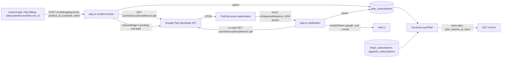

# Approval Box billing: Google Play (API v0.40)

Owner: Nayuta (bot-4366a50b). Canonical for the Google Play purchase path. The plan-sharing rules (one plan per account, the latest period end wins, `/me` shape) are in [billing-stripe.md](billing-stripe.md); this page adds the third store. Reason: the user rule requires Apple, Stripe and Google Play for a product with a PC version, and the Android app already starts Play Billing (`setObfuscatedAccountId(user_id)`, then `POST /v1/billing/play/verify {product_id, purchase_token}`).

## What the account answers

`GET /v1/me` does not change shape. A Play subscription only adds a source for the existing fields.

| Play subscription state (Google `subscriptionState`) | `plan` | `expires_at` | `store` |
| --- | --- | --- | --- |
| `ACTIVE`, `IN_GRACE_PERIOD`, or `CANCELED` (cancelled, period not over), with expiry in the future | `active` | line item `expiryTime` | `google_play` |
| `ON_HOLD`, `PAUSED`, `EXPIRED`, `PENDING`, or expiry passed | not paid: `expired` if nothing else is paid | last period end | store of the last paid period |

If another store also holds a paid period, the later period end decides (`Accounts.syncPlan`). The free month on Google Play is Play's own free-trial offer on the `monthly` base plan (all selling countries, set 2026-11-19); Google decides eligibility. Each store gives its own free month and the product keeps no trial state (Owner ruling 2026-11-20). While the Play trial runs, the state is `ACTIVE`, so the account reads `active`.

## Functions and data

| Function | Owner of state | Input → output | Failure / exit |
| --- | --- | --- | --- |
| `POST /v1/billing/play/verify` | `play_subscriptions` (purchase token, user id, product id, state, expiry, test flag) | login session (not a client session) + `{product_id, purchase_token}` → the account's `/me` after the update | 400 `validation_failed` for a product we do not sell or a token Google does not know (404/410); 409 `conflict` when Google's `obfuscatedExternalAccountId` is not this account or the token is already bound to another account; 409 `setup_not_verified` for a production purchase before the setup check (a `testPurchase` skips the gate); 404 `not_found` when this server has no Play (after the setup gate, like Stripe); 500 `internal` when Google cannot be reached or the acknowledge fails (the record is already saved; the app retries and the acknowledge is repeated) |
| `POST /v1/play/notifications` | `play_subscriptions` | Pub/Sub push: `Authorization: Bearer <OIDC token>` + `{message:{data}}` → `{applied}` | 401 when the OIDC token is missing, wrong audience, or the email is not the push service account; ignored (200 `{applied:false}`) for another package, `testNotification`, non-subscription events, a product we do not sell, an unknown or deleted account, or a token Google no longer knows, so Pub/Sub does not retry forever; 500 when Google cannot be reached, so Pub/Sub retries |
| `Accounts.syncPlan` | `users.plan, plan_expires_at, store` (derived) | all three subscription tables → plan | pure derivation, runs after every write |

Rules the code keeps:

- The notification is a nudge. State is never taken from the event body: the purchase is read again from Google, so late or duplicate events cannot move the period backwards.
- Paid means `subscriptionState` is `ACTIVE`, `IN_GRACE_PERIOD` or `CANCELED` and the line item's `expiryTime` is in the future.
- The account is bound by the `obfuscatedExternalAccountId` that the app sets at purchase (= `user_id`). A token belongs to the first account that verified it; a later claim by another account is refused (409), and a notification for a bound token updates that account only.
- The setup gate is decided only from Google's answer (`testPurchase` present = licence tester purchase), never from what the app says.
- Acknowledge: a purchase not acknowledged within 3 days is refunded by Google, so the server acknowledges after the record is saved and only for a paid, pending purchase.
- shortcut: `linkedPurchaseToken` (upgrade or resubscribe) is not merged. The old token simply expires, and the new token is verified as its own purchase. Upgrade this when a second product exists.
- Account deletion does not cancel a Play subscription (only the user can, in Play). The records are deleted with the account; later notifications for them are ignored.
- The BellTeam client session cannot call verify (allowlist). BellTeam only reads `/me`.

## Configuration

All of the following are required together, and `BILLING=store`; if anything is missing the server answers 404 for the two Play routes and nothing else changes.

| Variable | What | Delivery |
| --- | --- | --- |
| `PLAY_PRODUCT_IDS` | Comma-separated subscription product ids that we sell (not a secret) | compose environment |
| `PLAY_PACKAGE_NAME` | Android package name; default `dev.kitepon.approvalbox` | compose environment |
| `PLAY_CLIENT_EMAIL` | Service account e-mail (`client_email` field of the vault item; not a secret) | deploy env (`op://` ref) |
| `PLAY_PRIVATE_KEY(_FILE)` | Service account PEM private key (`private_key` field; literal `\n` accepted) with Play Console access | tmpfs file through `start-with-secrets.sh`, like the APNs key |
| `PLAY_PUSH_AUDIENCE` | Audience set on the Pub/Sub push subscription's OIDC token, normally `https://approval-box.kitepon.dev/v1/play/notifications` (not a secret) | compose environment |
| `PLAY_PUSH_SERVICE_ACCOUNT` | Email of the service account that Pub/Sub signs the push with (not a secret) | compose environment |

No dependency is added: Google's OAuth (JWT bearer, RS256) and the REST API are called with `fetch` and `node:crypto`, and the push token is checked with the existing `verifyIdToken("google", …)`.

## What the Owner sets up (Play Console and Google Cloud)

1. Play Console: a subscription product (¥300 per month) with a base plan. Give me the product id. The app must be published to at least an internal testing track for real purchases.
2. A service account in the linked Google Cloud project, invited in Play Console (Users and permissions) with permission to view financial data and manage orders. Its JSON key goes through `request_secret`. The Google Play Android Developer API must be enabled in that project.
3. Real-time developer notifications: a Pub/Sub topic, with Play Console's `google-play-developer-notifications@system.gserviceaccount.com` as publisher, set in Play Console "Monetization setup". A push subscription on that topic to `https://approval-box.kitepon.dev/v1/play/notifications` with authentication enabled: a service account (its email is `PLAY_PUSH_SERVICE_ACCOUNT`) and the audience (`PLAY_PUSH_AUDIENCE`).
4. Licence testers (Play Console, Settings) for test purchases.

## Not done here

- Merging `linkedPurchaseToken` (see above).
- Voided purchases (refund API) are not polled; a refund shows as the state change in the notification.
- Cancelling a Play subscription on account deletion (not possible without the user).
