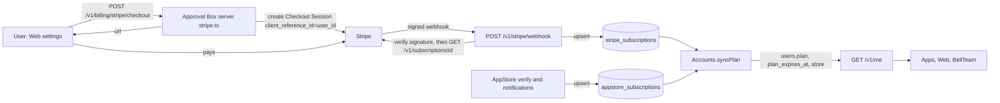

# Approval Box billing: Apple and Stripe (API v0.39)

Owner: Nayuta (bot-4366a50b). Canonical for the Stripe purchase path and for how the two stores share one account plan. Requested by Bready (BellTeam billing) after the Owner's decision of 2026-11-15: the ¥300/month plan must also be purchasable without Apple, so Web, Windows and Linux users can buy it. Apple stays as it is (`docs/api.md`, `/billing/appstore/verify`).

## What the account answers

One account has one plan. `GET /v1/me` is the only thing a reader (apps, BellTeam) needs; it does not change shape.

| Account state | `plan` | `expires_at` | `store` | Entitled (usable) |
| --- | --- | --- | --- | --- |
| New account, nothing bought | `trial` | absent (no end today) | absent | yes |
| Apple subscription in its paid period | `active` | period end | `app_store` | yes |
| Stripe subscription in its paid period | `active` | period end | `web` | yes |
| Stripe cancelled by the user, period not over | `active` | period end | `web` | yes, until `expires_at` |
| Period over, payment failed, refunded or cancelled at once | `expired` | last period end | store of the last paid period | no |
| Self-hosted server (`BILLING=off`) | `active` | absent | absent | yes |

Entitled = `plan` is `trial` or `active`. The new field `web_billing: true` appears only when this server can sell through Stripe (additive, for the Web screen). `store` for Stripe is `web`, the value the contract has had since v0.6 and the one the native apps already label "Webで契約中". It is the store, not the buyer's device, so Windows and Linux buyers also read `web`.

If both stores ever hold a paid period for the same account (someone paid twice), the one that ends later decides `expires_at` and `store`. Checkout refuses to start while a paid period is running (409 `conflict`), so this only happens when the second purchase is made in an app that did not know.

## Functions and data

| Function | Owner of state | Input → output | Failure / exit |
| --- | --- | --- | --- |
| `POST /v1/billing/stripe/checkout` | none (Stripe holds the session) | login session (not a client session) → `{url}` | 409 `setup_not_verified` before setup check (same gate as Apple); 409 `conflict` while a paid period runs; 404 `not_found` when this server has no Stripe; 500 `internal` when Stripe cannot be reached (no state written; press again) |
| `POST /v1/billing/stripe/portal` | none | login session → `{url}` of Stripe's customer portal (cancel, card, receipts) | 404 when there is no Stripe customer for the account |
| `POST /v1/stripe/webhook` | `stripe_subscriptions` (subscription id, user id, customer id, status, period end, cancel flag) | Stripe-Signature + raw body → the subscription is **read again from Stripe** and written | Bad or old signature 400. Stripe unreachable 500, so Stripe retries by itself (up to 3 days). Unknown account (deleted) is acknowledged and ignored |
| `Accounts.syncPlan` | `users.plan, plan_expires_at, store` (derived, never edited by hand) | both subscription tables → plan | pure derivation, runs after every write |
| `DELETE /v1/me` | — | cancels the account's Stripe subscriptions first, then deletes | Stripe cannot cancel → 500, nothing deleted (protects against charging a deleted account); retry, or cancel in the portal |

Rules the code keeps:

- The webhook is a nudge. State is never taken from the event body: the subscription is fetched from Stripe, so events arriving late or twice cannot move the period backwards.
- A subscription is paid only while Stripe's status is `active` and `current_period_end` is in the future. `past_due`, `unpaid`, `canceled`, `incomplete*` are not paid. A user who cancels in the portal keeps `active` until the period end (`cancel_at_period_end`), as with Apple.
- The account is bound by `client_reference_id` and by `subscription.metadata.user_id`, both set by this server at checkout. One Stripe subscription belongs to one account; a later event naming another account is ignored.
- The BellTeam client session (`/v1` allowlist) cannot start checkout or the portal. BellTeam only reads `/me`; it opens `https://approval-box.kitepon.dev/settings` for the user, who signs in and buys there. BellTeam copies no payment state.
- Apple apps show no Stripe button or link (App Review 3.1.1). A Stripe purchase is honoured in the apps because they read `/me` (3.1.3(b)); the plan is also sold as the existing in-app purchase.

## Configuration

All three are required together; if any is missing the server answers 404 for the Stripe routes, `web_billing` is absent and nothing else changes.

| Variable | What | Delivery |
| --- | --- | --- |
| `STRIPE_SECRET_KEY(_FILE)` | Stripe **restricted** key | tmpfs file through `start-with-secrets.sh`, like the APNs key |
| `STRIPE_WEBHOOK_SECRET(_FILE)` | Webhook signing secret `whsec_…` | same |
| `STRIPE_PRICE_ID` | Price id `price_…` (not a secret) | compose environment |

The restricted key needs only: Checkout Sessions **write**, Customer portal sessions **write**, Subscriptions **read** and **write** (write is only for cancelling on account deletion), Customers **read**. It cannot refund, create prices or move money.

## What the Owner sets up in the Stripe dashboard

1. Account activated; **Stripe Tax** on with the head-office address and the Japan registration (invoice registration number if registered).
2. Product "Approval Box" and a recurring Price: ¥300, monthly, `tax_behavior = inclusive` (so the buyer pays ¥300 as in the App Store). No trial period. Give me the `price_…` id.
3. Customer portal settings: cancel at the end of the period (not immediately), no proration refunds, card update on.
4. Webhook endpoint `https://approval-box.kitepon.dev/v1/stripe/webhook` with events `checkout.session.completed`, `customer.subscription.created`, `customer.subscription.updated`, `customer.subscription.deleted`. Its signing secret goes to `request_secret`.
5. The restricted key above through `request_secret`.

Refund policy (Owner, 2026-11-15): no refund for the current period; cancel = usable until the period ends. The code never refunds; a refund made by hand in Stripe leaves the plan as it is until the subscription ends. Cancelling immediately by hand in Stripe sets `expired` at once.

## Not done here

- Google Play (waits for the business registration).
- Stripe tax invoices and the invoice registration number are Stripe's and the Owner's side.
- Moving the key from `request_secret` into the host vault is the vault owner's step; the server reads it as a file either way.
