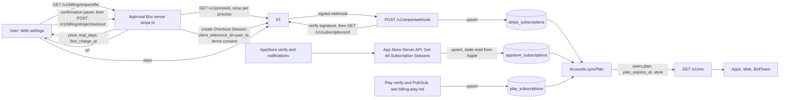

# Approval Box billing: Apple and Stripe (API v0.43)

Owner: Nayuta (bot-4366a50b). Canonical for the Stripe purchase path and for how the two stores share one account plan. Requested by Bready (BellTeam billing) after the Owner's decision of 2026-11-15: the ¥300/month plan must also be purchasable without Apple, so Web, Windows and Linux users can buy it. Apple stays as it is (`docs/api.md`, `/billing/appstore/verify`). Google Play is the third store and has its own page: [billing-play.md](billing-play.md).

## What the account answers

One account has one plan. `GET /v1/me` is the only thing a reader (apps, BellTeam) needs; it does not change shape.

| Account state | `plan` | `expires_at` | `store` | Entitled (usable) |
| --- | --- | --- | --- | --- |
| No subscription in any store (new account, never bought) | `expired` | absent | absent | no: sign-in, settings and purchase only; AI requests get 402 `subscription_expired` |
| Apple subscription in its paid period | `active` | period end | `app_store` | yes |
| Stripe subscription in its paid period (including the 30-day free trial, Stripe status `trialing`) | `active` | period end (the trial end while trialing) | `web` | yes |
| Google Play subscription in its paid period (state `ACTIVE`, `IN_GRACE_PERIOD`, or `CANCELED` with time left) | `active` | period end | `google_play` | yes |
| Stripe cancelled by the user, period not over | `active` | period end | `web` | yes, until `expires_at` |
| Period over, payment failed, refunded or cancelled at once | `expired` | last period end | store of the last paid period | no |
| Self-hosted server (`BILLING=off`) | `active` | absent | absent | yes |

Entitled = `plan` is `active`. The product keeps no trial or free-period state (Owner ruling 2026-11-20): the free month is each store's own free period, and while it runs the store reports a paid state (Stripe `trialing`, Apple introductory offer, Play free trial), so the account reads `active`. `plan=expired` without `store` means the account never had a subscription. `trial` is no longer returned; readers should treat any value other than `active` as not entitled. The new field `web_billing: true` appears only when this server can sell through Stripe (additive, for the Web screen). `store` for Stripe is `web`, the value the contract has had since v0.6 and the one the native apps already label "Webで契約中". It is the store, not the buyer's device, so Windows and Linux buyers also read `web`.

If two or more stores (Apple, Stripe, Google Play) ever hold a paid period for the same account (someone paid twice), the one that ends later decides `expires_at` and `store`. Checkout refuses to start while a paid period is running (409 `conflict`), so this only happens when the second purchase is made in an app that did not know.

## Functions and data

| Function | Owner of state | Input → output | Failure / exit |
| --- | --- | --- | --- |
| `GET /v1/billing/stripe/offer` | none (the Price is read from Stripe once and kept in memory for the process lifetime) | login session (not a client session) → `{amount, currency, interval: "month", trial_days, first_charge_at}`. `trial_days` is 30 when this account has no earlier Stripe subscription record, else 0 (the same `firstTime` check as checkout, one private method); `first_charge_at` = now + `trial_days` days (ISO). The Web confirmation panel shows it before checkout | 404 `not_found` when this server has no Stripe; 500 `internal` when Stripe cannot be reached (nothing written) |
| `POST /v1/billing/stripe/checkout` | none (Stripe holds the session) | login session (not a client session) → `{url}`. The session requires the buyer to accept the terms (`consent_collection[terms_of_service]=required`, with `custom_text[terms_of_service_acceptance][message]` linking the kitepon.dev terms and this product's annex `/terms.html`, and stating guardian consent for minors) | 409 `setup_not_verified` before setup check (same gate as Apple); 409 `conflict` while a paid period runs; 404 `not_found` when this server has no Stripe; 500 `internal` when Stripe cannot be reached (no state written; press again) |
| `POST /v1/billing/stripe/portal` | none | login session → `{url}` of Stripe's customer portal (cancel, card, receipts) | 404 when there is no Stripe customer for the account |
| `POST /v1/stripe/webhook` | `stripe_subscriptions` (subscription id, user id, customer id, status, period end, cancel flag) | Stripe-Signature + raw body → the subscription is **read again from Stripe** and written | Bad or old signature 400. Stripe unreachable 500, so Stripe retries by itself (up to 3 days). Unknown account (deleted) is acknowledged and ignored |
| `POST /v1/billing/appstore/verify`, `POST /v1/appstore/notifications` | `appstore_subscriptions` (original transaction id, user id, environment, product, expires_at, revoked) | the JWS or the notification is verified to Apple's root as before, then the state is **read again from Apple** (`GET /inApps/v1/subscriptions/{originalTransactionId}`, ES256 JWT with `APPSTORE_*`): status 1 → paid until the transaction `expiresDate`; 4 (billing grace period) → paid until `renewalInfo.gracePeriodExpiresDate`; 3 (billing retry), 2 (expired) → not paid; 5 or `revocationDate` → revoked. The same re-read runs in the background (once per 10 minutes per original transaction id) when `/me` or `assertCanUse` sees an expired plan while a non-revoked App Store record exists, so a lost renewal notification heals itself | Apple unreachable or key refused → 500 `internal` (a notification is retried by Apple; nothing written). Apple does not know the purchase → verify 400 `validation_failed`, notification ignored. No `APPSTORE_*` key → today's behaviour (state from the signed transaction), one startup log line says so |
| `Accounts.syncPlan` | `users.plan, plan_expires_at, store` (derived, never edited by hand) | both subscription tables → plan | pure derivation, runs after every write |
| `DELETE /v1/me` | — | cancels the account's Stripe subscriptions first, then deletes | Stripe cannot cancel → 500, nothing deleted (protects against charging a deleted account); retry, or cancel in the portal |

Rules the code keeps:

- Same for the App Store: a notification or the app's JWS is a nudge. After the signature is checked, the state comes from Apple's App Store Server API, so a lost `DID_RENEW` cannot leave a paying user expired and the billing grace period is honoured.
- The webhook is a nudge. State is never taken from the event body: the subscription is fetched from Stripe, so events arriving late or twice cannot move the period backwards.
- A subscription is paid only while Stripe's status is `active` and `current_period_end` is in the future. `past_due`, `unpaid`, `canceled`, `incomplete*` are not paid. A user who cancels in the portal keeps `active` until the period end (`cancel_at_period_end`), as with Apple.
- The Stripe account is shared with other products, so a subscription the server has not recorded yet is handled only when one of its items has the price `STRIPE_PRICE_ID`. Other products' subscriptions, checkouts, invoices and charges get 200 and change nothing, whatever metadata they carry.
- The account is bound by `client_reference_id` and by `subscription.metadata.user_id`, both set by this server at checkout. One Stripe subscription belongs to one account; a later event naming another account is ignored.
- Before checkout the Web Settings screen opens a confirmation panel (plan and period, auto-renewal, price, payment methods, first charge date and amount from `/billing/stripe/offer`, when service starts, how to cancel, the no-refund line, links to the common terms, this product's annex terms and the 特定商取引法に基づく表記). Only its primary button calls checkout. Stripe then collects the terms consent.
- The BellTeam client session (`/v1` allowlist) cannot start checkout, the offer or the portal. BellTeam only reads `/me`; it opens `https://approval-box.kitepon.dev/settings` for the user, who signs in and buys there. BellTeam copies no payment state.
- Apple apps show no Stripe button or link (App Review 3.1.1). A Stripe purchase is honoured in the apps because they read `/me` (3.1.3(b)); the plan is also sold as the existing in-app purchase.

## Independence from BellTeam

Approval Box is its own service; BellTeam is one of its clients. BellTeam (or any client) never holds payment state: it opens `/settings` where the user buys, and reads `/me`. The one free month and the free operator account are Approval Box rules, not BellTeam's.

## Configuration

All three are required together; if any is missing the server answers 404 for the Stripe routes, `web_billing` is absent and nothing else changes.

| Variable | What | Delivery |
| --- | --- | --- |
| `STRIPE_SECRET_KEY(_FILE)` | Stripe **restricted** key | tmpfs file through `start-with-secrets.sh`, like the APNs key |
| `STRIPE_WEBHOOK_SECRET(_FILE)` | Webhook signing secret `whsec_…` | same |
| `STRIPE_PRICE_ID` | Price id `price_…` (not a secret) | compose environment |
| `APPSTORE_ISSUER_ID`, `APPSTORE_KEY_ID`, `APPSTORE_PRIVATE_KEY(_FILE)` | Optional, all three together. App Store Connect API key (Users and Access > Integrations > In-App Purchase) for the App Store Server API; the key is the `.p8` PEM. Without them the server keeps the old behaviour and logs one line at startup | ids: compose environment; key: tmpfs file through `start-with-secrets.sh` |
| `FREE_ACCOUNT_IDS` | Optional. Comma-separated user ids outside billing (the operator's own account, Owner ruling 2026-11-15). `/me` answers `active` with no `expires_at` or `store`; `assertCanUse` never refuses them. Not a secret | compose environment |
| `STRIPE_PORTAL_CONFIGURATION` | Optional. Customer portal configuration `bpc_…` made for Approval Box (cancel at period end, no proration). Set it when the Stripe account is shared with another product: without it Stripe uses the account's default portal, which belongs to the other product | compose environment |

The restricted key needs only: Checkout Sessions **write**, Customer portal sessions **write**, Subscriptions **read** and **write** (write is only for cancelling on account deletion), Customers **read**. It cannot refund, create prices or move money.

## What the Owner sets up in the Stripe dashboard

1. Account activated; **Stripe Tax** on with the head-office address and the Japan registration (invoice registration number if registered).
2. Product "Approval Box" and a recurring Price: ¥300, monthly, `tax_behavior = inclusive` (so the buyer pays ¥300 as in the App Store). The free month is not on the Price: checkout adds `subscription_data[trial_period_days]=30` only for an account with no earlier Stripe subscription record. Each store gives its own free month; a person may get one from each store (Owner ruling 2026-11-20, replacing the cross-store rule of 2026-11-15). The card is collected at checkout; the first charge comes after 30 days. Apple's side is an introductory offer in App Store Connect. Give me the `price_…` id.
3. Customer portal settings: cancel at the end of the period (not immediately), no proration refunds, card update on.
4. Webhook endpoint `https://approval-box.kitepon.dev/v1/stripe/webhook` with events `checkout.session.completed`, `customer.subscription.created`, `customer.subscription.updated`, `customer.subscription.deleted`. Its signing secret goes to `request_secret`.
5. The restricted key above through `request_secret`.

Refund policy (Owner, 2026-11-15): no refund for the current period; cancel = usable until the period ends. The code never refunds; a refund made by hand in Stripe leaves the plan as it is until the subscription ends. Cancelling immediately by hand in Stripe sets `expired` at once.

## Not done here

- Google Play is described in [billing-play.md](billing-play.md). Each store gives its own free month (Apple introductory offer, Play free trial, Stripe 30 days for an account without an earlier Stripe subscription).
- Stripe tax invoices and the invoice registration number are Stripe's and the Owner's side.
- Moving the key from `request_secret` into the host vault is the vault owner's step; the server reads it as a file either way.
