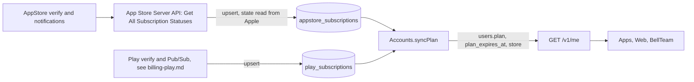

# Approval Box billing: App Store and Google Play (API v0.45)

Owner: Nayuta (bot-4366a50b). Canonical for how the stores share one account plan. The Owner abolished Stripe in every app (2026-11-20): the ¥300/month plan is sold only through the App Store (iPhone, Mac) and Google Play (Android). Stripe had no subscribers when it was removed, and production already ran without it. Google Play has its own page: [billing-play.md](billing-play.md).

## What the account answers

One account has one plan. `GET /v1/me` is the only thing a reader (apps, BellTeam) needs; it does not change shape except that `web_billing` and `store: "web"` are gone.

| Account state | `plan` | `expires_at` | `store` | Entitled (usable) |
| --- | --- | --- | --- | --- |
| No subscription in any store (new account, never bought) | `expired` | absent | absent | no: sign-in, settings and purchase only; AI requests get 402 `subscription_expired` |
| Apple subscription in its paid period | `active` | period end | `app_store` | yes |
| Google Play subscription in its paid period (state `ACTIVE`, `IN_GRACE_PERIOD`, or `CANCELED` with time left) | `active` | period end | `google_play` | yes |
| Period over, payment failed, refunded or cancelled at once | `expired` | last period end | store of the last paid period | no |
| Self-hosted server (`BILLING=off`) | `active` | absent | absent | yes |

Entitled = `plan` is `active`. The product keeps no trial or free-period state (Owner ruling 2026-11-20): the free month is each store's own free period, and while it runs the store reports a paid state (Apple introductory offer, Play free trial), so the account reads `active`. `plan=expired` without `store` means the account never had a subscription. `trial` is no longer returned; readers should treat any value other than `active` as not entitled. A reader that sees a `store` it does not know (the old `web`) treats it as "other".

If both stores ever hold a paid period for the same account (someone paid twice), the one that ends later decides `expires_at` and `store`.

## Functions and data

| Function | Owner of state | Input → output | Failure / exit |
| --- | --- | --- | --- |
| `POST /v1/billing/appstore/verify`, `POST /v1/appstore/notifications` | `appstore_subscriptions` (original transaction id, user id, environment, product, expires_at, revoked) | the JWS or the notification is verified to Apple's root as before, then the state is **read again from Apple** (`GET /inApps/v1/subscriptions/{originalTransactionId}`, ES256 JWT with `APPSTORE_*`): status 1 → paid until the transaction `expiresDate`; 4 (billing grace period) → paid until `renewalInfo.gracePeriodExpiresDate`; 3 (billing retry), 2 (expired) → not paid; 5 or `revocationDate` → revoked. The same re-read runs in the background (once per 10 minutes per original transaction id) when `/me` or `assertCanUse` sees an expired plan while a non-revoked App Store record exists, so a lost renewal notification heals itself | Apple unreachable or key refused → 500 `internal` (a notification is retried by Apple; nothing written). Apple does not know the purchase → verify 400 `validation_failed`, notification ignored. No `APPSTORE_*` key → state from the signed transaction, one startup log line says so |
| `POST /v1/billing/play/verify`, `POST /v1/play/notifications` | `play_subscriptions` | see [billing-play.md](billing-play.md) | see [billing-play.md](billing-play.md) |
| `Accounts.syncPlan` | `users.plan, plan_expires_at, store` (derived, never edited by hand) | both subscription tables → plan | pure derivation, runs after every write |
| `DELETE /v1/me` | — | deletes the account and its records. It cancels no subscription: the user cancels in the App Store or Google Play | file delete fails → 5xx, nothing deleted |

Rules the code keeps:

- A notification or the app's JWS is a nudge. After the signature is checked, the state comes from Apple's App Store Server API, so a lost `DID_RENEW` cannot leave a paying user expired and the billing grace period is honoured.
- The BellTeam client session (`/v1` allowlist) cannot call the verify routes. BellTeam only reads `/me`; it copies no payment state.
- The apps show the store they bought from, and show no purchase screen for another store while a plan is active.

## Independence from BellTeam

Approval Box is its own service; BellTeam is one of its clients. BellTeam (or any client) never holds payment state: it reads `/me`. A user buys in the iPhone, Mac or Android app; the Web settings screen only tells them so. The free operator account is an Approval Box rule, not BellTeam's.

## Configuration

If a store's settings are missing the server answers 404 for its routes and nothing else changes.

| Variable | What | Delivery |
| --- | --- | --- |
| `APPSTORE_ISSUER_ID`, `APPSTORE_KEY_ID`, `APPSTORE_PRIVATE_KEY(_FILE)` | Optional, all three together. App Store Connect API key (Users and Access > Integrations > In-App Purchase) for the App Store Server API; the key is the `.p8` PEM. Without them the server keeps the old behaviour and logs one line at startup | ids: compose environment; key: tmpfs file through `start-with-secrets.sh` |
| `FREE_ACCOUNT_IDS` | Optional. Comma-separated user ids outside billing (the operator's own account, Owner ruling 2026-11-15). `/me` answers `active` with no `expires_at` or `store`; `assertCanUse` never refuses them. In library mode the values are K values (the deploy changes them). Not a secret | compose environment |
| `LB_K_KEY`, `LB_PASS_KEY`, `LB_PASS_KEY_ID` (`LB_PASS_KEY_PREVIOUS`, `LB_PASS_KEY_PREVIOUS_ID` while rotating) | Optional, the first three together. Switch on library mode (shared login and billing library, mounted at `/auth/v1`; [login-pass.md](architecture/login-pass.md)). Keys are base64url (K key 32+ bytes, pass key 32 bytes). Library mode also reads `APPLE_AUDIENCES`, `GOOGLE_CLIENT_IDS`, `APPSTORE_ISSUER_ID/KEY_ID/PRIVATE_KEY`, `PLAY_CLIENT_EMAIL/PRIVATE_KEY`, `BILLING`. Without the three keys the server behaves as before and logs one line | ids: compose environment; keys: tmpfs files through `start-with-secrets.sh` (`LB_K_KEY_FILE`, `LB_PASS_KEY_FILE`, `LB_PASS_KEY_PREVIOUS_FILE`) |
| `LB_REKEY_DELETE_IDS` | Library mode only. Comma-separated ids of the identity-less test accounts the one-time rekey deletes. The rekey runs only if the users without an identities row are exactly these ids and every other precondition holds; otherwise it changes nothing and library mode stays off. Not a secret; remove after the deploy | compose environment |

The Google Play variables are in [billing-play.md](billing-play.md).

## Stripe removal (2026-11-20)

Removed: `stripe.ts`, `/billing/stripe/*`, `/stripe/webhook`, `web_billing`, `store: "web"`, the `STRIPE_*` variables and the Web checkout panel. Migration 15 drops the `stripe_subscriptions` table (it held no rows in production). `appstore.ts` keeps the status table above. Next step (chart login-billing): the shared login and billing library replaces both store paths ([login-pass.md](architecture/login-pass.md)).
