# Approval Box Web client: screen-transition map

> **Reopened on 2026-11-28 as a child device of the account (Owner ruling, 19:28 JST).** It was closed on 2026-11-21 (only `/pair` stayed). Now a browser joins an account only when a phone (parent) of the same account reads its QR; from then on it is one device of the account like the phone apps (login-billing 0.28.1 browser part, chart task w01). It cannot buy, cannot approve an AI or app connection, and cannot delete the account (a child leaves with `ログアウト`).

Scope: `packages/web/src` only (a Preact single-page app). The spec is `docs/architecture/screens.md` (state ids S1-S9 below are the spec's). Where the Web cannot follow the spec, section 9 says so and why.

- Labels are quoted as the ja-JP UI shows them. English and the other locales are in `packages/web/src/messages.ts` / `messages-east-asian.ts` (the Japanese text is the catalog key).
- Citations are `file` / function names relative to `packages/web/src/` (line numbers are not used, they drift); `server/` means `packages/server/src/`.
- Screenshots: `docs/screenshots/web/<state-id>-390.png` (390x844 phone width) and `-1280.png` (1280x800 desktop), ja-JP, generated by `tools/screens/capture-web.ts` against a stubbed API (section 10). The library's browser part runs for real in them (key in IndexedDB, signed requests); the server, Google's pop-up and Apple's script are stubbed.
- Where a claim comes from reading the server rather than the Web code, it says so.

## 1. Shell

- **No language picker at the top.** The picker (`言語`, drop-down `システムに合わせる` / `日本語` / `English` / `한국어` / `简体中文` / `繁體中文`, language.tsx) is on S1 (last line) and in S8 `言語`. Nowhere else.
- **Menu** (signed in only, main.tsx `Nav`): four links in this order: `受信` (with a count badge of pending requests), `履歴`, `接続`, `設定`. Phone width (< 720px): tab bar fixed to the bottom. Desktop: a bar at the top (style.css).
- **Page heading = menu label**: `受信`, `履歴`, `接続`, `設定` (the request screen S5 has the heading `相談`).
- **Highlight follows the page you came from.** `受信` is active on `/` and on `/d/...` opened from 受信; `履歴` on `/history` and on `/d/...` opened from 履歴 (the origin travels in `history.state.from`, router.ts `navigate`/`linkProps`/`listPath`); `接続` on `/connections` and `/pair`; `設定` on `/settings` and `/plan`. An unknown path shows the inbox with `受信` not highlighted.
- Browser tab title: `(n) Approval Box` when n requests are pending.
- Error alert (S9, dialog.tsx `AlertHost`/`showAlert`): a modal with title `確認してください`, the message, and `閉じる`. Native `confirm` remains for destructive actions (deleting history, removing a connection).

## 2. Routes (main.tsx `App`)

| URL | Screen | Needs sign-in |
|---|---|---|
| `/` (and any unknown path) | S3 受信 | yes |
| `/d/<id>` | S5 相談 | yes |
| `/history` | S4 履歴 | yes |
| `/connections` | S6 接続 | yes |
| `/pair?c=<code>` | pairing request (part of S6; a child cannot approve) | yes |
| `/plan` | S7 契約 | yes |
| `/settings` | S8 設定 | yes |
| `/login` | rewritten to `/` (retired bookmark) | - |
| `/auth/google/callback`, `/auth/apple/callback` | the sign-in pop-up lands here; the page renders nothing (the opener reads the result and closes it) | - |

When signed out, every URL shows S1 at the same URL; after signing in you stay on the URL you were on. Signing out navigates to `/`.

## 3. Sign-in: the browser as a child device

- device.ts: one `BrowserDevice("dev.kitepon.approvalbox", new IndexedDbKeyStore(appId), { keysUrl: "<origin>/v1/keys/" })` (login-billing 0.28.1 `@kitepon/login-billing/web`). Its key is a non-extractable P-256 pair in this origin's IndexedDB.
- The browser signs in itself: Google through its OAuth pop-up (`signInGoogle`, response_type id_token, scope openid, the id token in the fragment of `<origin>/auth/google/callback`; never Google Identity Services) or Apple through Sign in with Apple JS (`signInApple`, the page loads Apple's script when S1 shows, redirect URI `<origin>/auth/apple/callback`). The client ids are the public `google_client_id` / `apple_services_id` of `GET /v1/auth/config` (fetched without a signature). The id token goes only into the QR; the server never receives it.
- `makeRequest({ provider, signIn })` gives the QR; a phone of the same account reads it and admits the browser (`POST /v1/keys/admit`, signed by the phone). The page polls `keys/me` every 3 seconds until it answers `{ entry, role }`, then calls `navigator.storage.persist()` once (a refusal changes nothing) and opens the app.
- Every `/v1` request (API calls, uploads with their bytes, the event stream) carries `Login-Billing-Key` signed for that request (api.ts `send`); no `Authorization`, no cookie. The API is the same origin, so there is no CORS.
- At start (boot): no kept key -> S1; a kept key -> `keys/me`: admitted -> the app, not admitted -> S1.

## 4. States

"Shell" = menu (signed in) as in section 1.

### Signed out

**boot** `-` main.tsx. An empty page until the kept key is read and `keys/me` answers. Shots: [390](screenshots/web/boot-390.png) [1280](screenshots/web/boot-1280.png)

**S1 `ログイン`** login.tsx `Login`. In order: `Approval Box`; `AIの相談に、スマホやPCから答えます。`; `Google か Apple でログインすると QR が出ます。同じアカウントの iPhone の決裁箱でその QR を読むと、このブラウザが使えるようになります。`; the buttons `Googleでログイン` and `Appleでサインイン` (each only when `/auth/config` has its client id; nothing starts until one is pressed); disclosure `はじめての方へ` with two steps (store sign-in and subscribe on a phone; `PCでコマンドを実行して、AIとつなぎます。` + `npx -y approval-box@latest setup` + `コマンドをコピー`); links `利用規約` `プライバシーポリシー` `サポート`; the language picker. Shots: `login` [390](screenshots/web/login-390.png) [1280](screenshots/web/login-1280.png); disclosure open `login-first-time` [390](screenshots/web/login-first-time-390.png) [1280](screenshots/web/login-first-time-1280.png); a sign-in that failed (red `ログインできませんでした。`) `login-apple-error` [390](screenshots/web/login-apple-error-390.png) [1280](screenshots/web/login-apple-error-1280.png); no client id configured (`このサーバーにはログインの設定がありません。…`) `login-none` [390](screenshots/web/login-none-390.png) [1280](screenshots/web/login-none-1280.png). A blocked pop-up shows `ポップアップが止められました。このページのポップアップを許可してから、もう一度押してください。`; closing the pop-up shows nothing.

**S1b** banner on S1, only after a signed-in browser got a 401 (a first visit shows no banner): `ログインが切れました。もう一度ログインしてください。` (the key was removed from the phone, or the browser lost it: `not_signed_in`). `login-banner` [390](screenshots/web/login-banner-390.png) [1280](screenshots/web/login-banner-1280.png). A clock that is off (`time_off`) is not a sign-out: the call fails with `この端末の時計がずれています。時計を合わせてから、もう一度試してください。` (and at boot S1 shows that text).

**S2 `スマホの承認を待っています`** login.tsx. `同じアカウントの iPhone の決裁箱でこの QR を読んでください`; the QR (accessible name `QRコード`, 700 px wide: the token is long; on a phone-width screen it scrolls sideways); `HH:MMまで有効` (10 minutes, the browser's consent in the QR); button `やめる` (-> S1). After 10 minutes: S1 with the red `QRの期限が切れました。もう一度ログインしてください。`. Shots: `login-qr` [390](screenshots/web/login-qr-390.png) [1280](screenshots/web/login-qr-1280.png)

### Signed in

**S3 `受信`** `/` pages/Inbox.tsx. Shell; `h1` `受信`; chips `すべて` `未回答` `保留` (default `すべて`; pending first, held after); search field `相談を検索` (client-side, on title and `申請者 / 作業名`); one card per request: client chip, requester + work name, age, title, tags (`急ぎ`, deadline, `保留中`, `修正あり`, `テスト`). Nothing pending: `いま決めることはありません` / `相談が届いたら、お知らせします。`. Search with no hit: `この条件の相談はありません`. Each card carries its status word as the first tag: `未回答` or `保留`. A card opens S5. Shots: `inbox` [390](screenshots/web/inbox-390.png) [1280](screenshots/web/inbox-1280.png); `inbox-held` (chip `保留`) [390](screenshots/web/inbox-held-390.png) [1280](screenshots/web/inbox-held-1280.png); `inbox-search-none` [390](screenshots/web/inbox-search-none-390.png) [1280](screenshots/web/inbox-search-none-1280.png); `inbox-empty` [390](screenshots/web/inbox-empty-390.png) [1280](screenshots/web/inbox-empty-1280.png)

**S4 `履歴`** `/history` pages/History.tsx. The list is **this browser's history** (history.ts, IndexedDB `approval-box-history` of the origin, api.md v0.51 e02): the list shows the copies at once, and behind it the decided requests the server still holds are back-filled newest first with their files (request and answer attachments) and acked with `POST /decisions/{id}/stored` only once every file is saved (a file that fails is tried again on the next load); these calls are paced at 2 a second, a pass cut short resumes on the next load, and a 429 pauses them until Retry-After; the list refreshes as copies arrive; copies older than the account's `保存期間` or of another account are dropped. The server deletes a decided request's content once every device acked it, so the copy here is what stays. `h1` `履歴`; chips `すべて` `回答済み` `取り下げ`; search `相談を検索`; cards (date, title, then the tags `回答済み` + the chosen option or `文で回答` + a delivery tag, or `取り下げ` + the reason). No match for a chip or search: `この条件の相談はありません`. Empty: `まだ履歴はありません` / `あなたの回答が、ここに残ります。`. Cards open S5 with `from: history`. **No delete button here**; deleting history is only in S8. Shots: `history` [390](screenshots/web/history-390.png) [1280](screenshots/web/history-1280.png); `history-empty` [390](screenshots/web/history-empty-390.png) [1280](screenshots/web/history-empty-1280.png)

**S5 `相談`** `/d/<id>` pages/DecisionView.tsx. Shell (highlight per section 1); `戻る`; client chip, requester / work, age; `h1` `相談`; the title as an `h2` (same size as the old title); tags (urgency, deadline, `テスト`, `接続: <name>`, the id); optional boxes `AIが修正しました` and `似た申請と別件である理由`; `背景` + the context; `AIの添付画像`. Answerable (pending or held), in this order: `どう進める？` (options as radio buttons, `AIの推奨` badge on the recommendation; nothing is preselected); `補足・別の指示`; one button `画像・書類を添付` (opens the browser's file picker; the attached files are listed above it; the hint `最大10件・1件20MB・合計50MB` below); then one row with `保留する` / `保留を解除` and `回答を送信` (enabled once an option is chosen, or text or an attachment is present). Answered: `あなたの回答` (option label or text, attachments), the delivery state (`AIへの配送待ち` / `AIへ届いた` / `届いたか不明` / `AIが受け取った`, with the explanation for unknown), and `再開の一言をコピー`. Cancelled: `AIが取り下げました` + reason. A collapsed `履歴` (timeline) is at the bottom. A decided request whose content the server removed (a tombstone, `content_removed: true`) or that it no longer has (404), or any request while offline, is shown from this browser's history, files included, with the delivery state the tombstone carries (d01); with no copy here the tombstone shows with `この申請の中身はサーバーから消えました。この端末の履歴にもありません。`. Answering keeps the answered request in the history at once. Banners (grey, above the chip): `AIがこの申請を取り下げました。`, `AIが内容を直しました。内容を確かめてから答えてください。`, or the server's message when hold/answer fails.
Shots: `decision-open` [390](screenshots/web/decision-open-390.png) [1280](screenshots/web/decision-open-1280.png); option chosen [390](screenshots/web/decision-open-chosen-390.png) [1280](screenshots/web/decision-open-chosen-1280.png); amended [390](screenshots/web/decision-open-amended-390.png) [1280](screenshots/web/decision-open-amended-1280.png); held [390](screenshots/web/decision-held-390.png) [1280](screenshots/web/decision-held-1280.png); answered [390](screenshots/web/decision-answered-390.png) [1280](screenshots/web/decision-answered-1280.png); answered, delivery unknown [390](screenshots/web/decision-answered-unknown-390.png) [1280](screenshots/web/decision-answered-unknown-1280.png); cancelled [390](screenshots/web/decision-cancelled-390.png) [1280](screenshots/web/decision-cancelled-1280.png); content removed, no copy here [390](screenshots/web/decision-removed-390.png) [1280](screenshots/web/decision-removed-1280.png); load error (red message + `受信一覧へ`) [390](screenshots/web/decision-error-390.png) [1280](screenshots/web/decision-error-1280.png)

**S6 `接続`** `/connections` pages/Connections.tsx. `h1` `接続`; sections in the spec's order:
1. `AIをつなぐ`: the PC command with `コマンドをコピー`; `PCでコマンドを実行すると、8文字のコードとQRが出ます。そのコードを下の欄に入れるか、QRを読みます。` (before the command); field `ABCD-EFGH` + `コードを確認` (-> `/pair?c=`). No `QRコードを読む` (section 9).
2. `つないだAI`: one row per connection (name, OS, last seen) with `外す` (native confirm). Empty: `まだつないだAIはありません。`
3. `接続テスト`: per device `テストする` (shows the hint to tell the AI `Approval Boxのsetup_testを実行して`) and the state line per AI client (`未テスト` / `答え待ち` / `AIへ配送中` / `確認済み` / `失敗` with the reason). When a check is `答え待ち` and the server gave its request id, `接続テストの申請を開く` opens S5 directly. Empty: `AIをつなぐと、ここでテストできます。`
4. `AIごとの登録手順`: one block per AI (Claude Code, Codex, Cursor, Grok) with its title and steps, taken from the server's `GET /onboarding` (the same endpoint, hence the same texts, the Android app uses; the server picks the language from `Accept-Language`). A step that has a command to copy gets the button `登録手順をコピー` (copies the command; `コピーしました` for 2s). Source: Connections.tsx `Guides`.
5. `画面のない端末を登録` (disclosure): a name field + `トークンを作る` (`POST /tokens`); the command with the token is shown once with `コマンドをコピー`. The new connection then appears under `つないだAI`.
Shots: `connections-empty` [390](screenshots/web/connections-empty-390.png) [1280](screenshots/web/connections-empty-1280.png); `connections` [390](screenshots/web/connections-390.png) [1280](screenshots/web/connections-1280.png); test hint [390](screenshots/web/connections-test-hint-390.png) [1280](screenshots/web/connections-test-hint-1280.png); token [390](screenshots/web/connections-token-390.png) [1280](screenshots/web/connections-token-1280.png)

**pair** `/pair?c=<code>` (from S6 or a link). The lookup shows who asks, as before: own device: `h1` `AIをつなぐ`, `このAIをつなぎますか？`, name / OS / AI list; registered app (BellTeam): `h1` `アプリの接続を許可`, the consent text. **The browser is a child, and only a parent device approves (Owner 2026-11-24; the server answers a child 403 `parent_required`)**: instead of `つなぐ` / `許可する` the page says `この接続は、同じアカウントの iPhone・iPad・Mac・Android の決裁箱アプリで承認してください。ブラウザでは承認できません。` and offers only `心当たりがない` / `許可しない` (a child may reject). A 403 `parent_required` (if a parent-only button were reached anyway) shows the same text. After rejecting: a notice and `接続へ`. Lookup failure: red server message. Shots: `pair-device` [390](screenshots/web/pair-device-390.png) [1280](screenshots/web/pair-device-1280.png); `pair-client` [390](screenshots/web/pair-client-390.png) [1280](screenshots/web/pair-client-1280.png); `pair-rejected` [390](screenshots/web/pair-rejected-390.png) [1280](screenshots/web/pair-rejected-1280.png); `pair-error` [390](screenshots/web/pair-error-390.png) [1280](screenshots/web/pair-error-1280.png)

**S7 `契約`** `/plan` pages/Plan.tsx. Opened from S8 `契約について`. A signed request's `GET /me` has no plan, store or expiry (api.md v0.50: the paid check is on each device), and the server never refuses a signed request for payment, so the Web shows no status line and is never sent here by a 402. Content: the "cannot buy here" block `この端末では契約できません。契約は、iPhone・iPad・Mac または Android の決裁箱で、設定 → 契約 から行います。`; `1か月ごとの自動更新。解約は、契約したストアの管理画面から行えます。`; links `利用規約` `プライバシーポリシー` `特定商取引法に基づく表記`; `ログアウト`. A self-hosted server (`billing: off`) shows `このサーバーは自分で立てたもので、料金はかかりません。` instead of the billing text. Shots: `plan` [390](screenshots/web/plan-390.png) [1280](screenshots/web/plan-1280.png); `plan-selfhost` [390](screenshots/web/plan-selfhost-390.png) [1280](screenshots/web/plan-selfhost-1280.png)

**S8 `設定`** `/settings` pages/Settings.tsx. `h1` `設定`; panels in the spec's order:
1. `アカウント`: `スマホの承認でログインしています`.
2. `契約`: the cannot-buy sentence (self-hosted: the free sentence) + `契約について` -> S7.
3. `ほかの端末`: `この端末は、ほかの端末をログインさせられません。止めるときは、承認したスマホの 設定 → ほかの端末 から止めます。`
4. `通知`: `ブラウザ版には通知がありません。通知はスマホとPCのアプリで受け取れます。`
5. `言語`: the picker.
6. `履歴の保存`: `保存期間` (7 / 30 / 90 / 365 days, saves at once; this browser's history follows it), `履歴を削除` (confirm, then the server's decided requests and this browser's history go; `N件消しました。`).
7. `ヘルプ`: `使い方・お問い合わせ` (`/support.html`), `利用規約`, `プライバシーポリシー`.
8. `アカウント管理`: `保存されている情報の写しを受け取る`, `ログアウト`. No account deletion: a signed `DELETE /me` is 409; the account's content goes when its last device leaves (read from `server/http.ts`).
Shots: `settings` [390](screenshots/web/settings-390.png) [1280](screenshots/web/settings-1280.png); self-hosted [390](screenshots/web/settings-selfhost-390.png) [1280](screenshots/web/settings-selfhost-1280.png); a failed `履歴を削除` showing S9 [390](screenshots/web/settings-alert-390.png) [1280](screenshots/web/settings-alert-1280.png)

**S9** `確認してください` alert, dialog.tsx: raised by failed actions in S6 and S8 (settings save, history delete, export, connection removal, token creation, sign-out failure). Inline errors (list load failures, sign-in errors, pairing lookup) stay in the page as red text.

Native dialogs (cannot be screenshotted): confirm `答え済みの履歴を全部消します。未決は残ります。よろしいですか？` (S8); confirm before `外す` (S6).

## 5. Transition table

All rows were checked by `tools/screens/capture-web.ts` or `packages/web/test/browser/*.spec.ts` unless marked "code only".

### 5.1 Start-up and sign-in

| From | Operation / trigger | To | Source |
|---|---|---|---|
| (page load) | auto | boot | main.tsx |
| boot | a kept key, `keys/me` answers its entry | S3 (or the URL typed) | main.tsx |
| boot | no kept key, or `keys/me` 401 `not_signed_in` | S1 (no banner) | main.tsx |
| boot | `keys/me` fails otherwise (`time_off`, network) | S1 with that reason (code only) | main.tsx |
| S1 | `Googleでログイン` / `Appleでサインイン` -> the provider's pop-up -> `makeRequest` | S2 | login.tsx `start` |
| S1 | the pop-up is closed | S1, nothing shown | login.tsx |
| S1 | the pop-up is blocked / sign-in fails | S1 with the red message | login.tsx |
| S1 | `はじめての方へ` | opens in place | login.tsx |
| S1 | a link | `/terms.html` `/privacy.html` `/support.html` (new tab) | login.tsx |
| S1 | language picker | same screen, relabelled | language.tsx |
| S2 | a phone of the same account admits it (`keys/me` answers) | S3 (stays on the typed URL) | login.tsx |
| S2 | `やめる` | S1 | login.tsx |
| S2 | 10 minutes pass | S1 with `QRの期限が切れました。もう一度ログインしてください。` (code only) | login.tsx |

### 5.2 Menu and links (signed in)

| From | Operation | To | Source |
|---|---|---|---|
| any | menu `受信` / `履歴` / `接続` / `設定` | `/` `/history` `/connections` `/settings` | main.tsx `Nav` |
| S3 | a card | S5 (`from` unset, `受信` highlighted) | Inbox.tsx |
| S4 | a card | S5 with `from: history` (`履歴` highlighted) | History.tsx |
| S5 | `戻る` | browser back, or the origin list if there is no history | DecisionView.tsx, router.ts `listPath` |
| S5 (touch) | horizontal swipe 80px+ | the origin list (`/` or `/history`) | DecisionView.tsx |
| S5 | choose an option, `回答を送信` | stays on the same request, now showing `あなたの回答` | DecisionView.tsx `act` |
| S5 | `保留する` / `保留を解除` | stays; flips | DecisionView.tsx |
| S5 | `再開の一言をコピー` (answered) | stays; button reads `コピーしました` for 2s | DecisionView.tsx |
| S5 error | `受信一覧へ` | S3 | DecisionView.tsx |
| S6 | code + `コードを確認` | pair `/pair?c=<code>` (empty field: nothing) | Connections.tsx |
| S6 | `テストする` | same screen, hint shown | Connections.tsx |
| S6 | `接続テストの申請を開く` (check is `答え待ち` with a request id) | S5 of that request (works without a contract; code only: the id comes from the server) | Connections.tsx `checkLine` |
| S6 | `外す` | native confirm; yes -> row removed, same screen | Connections.tsx |
| S6 | `画面のない端末を登録` -> `トークンを作る` | same screen, command shown once | Connections.tsx `Tokens` |
| pair | `心当たりがない` / `許可しない` (`つなぐ` / `許可する` are not shown: a child cannot approve) | pair-rejected | Connections.tsx `Pair` |
| pair-rejected | `接続へ` | S6 | Connections.tsx |
| S8 | `契約について` | S7 `/plan` | Settings.tsx |
| S8 | retention drop-down | saves; stays | Settings.tsx |
| S8 | `履歴を削除` | confirm; yes -> the server's decided requests and this browser's history deleted, `N件消しました。` (the larger of the two counts), stays | Settings.tsx |
| S8 | `保存されている情報の写しを受け取る` | downloads `approval-box-export-<date>.json`; stays | Settings.tsx, api.ts |
| S8 | `ログアウト` | `keys/leave`, then the key and this browser's history are deleted; S1 at `/` (no banner) | account.ts `logout` |
| S8 | `ヘルプ` links, GitHub download | external / static pages (new tab) | Settings.tsx |
| S7 | `ログアウト` | `keys/leave`, S1 at `/` | Plan.tsx, account.ts |
| S7 | `特定商取引法に基づく表記`, `利用規約`, `プライバシーポリシー` | external / static pages (new tab) | Plan.tsx |
| any | `/login` | URL rewritten to `/` | main.tsx |
| any | unknown path | S3, nothing highlighted | main.tsx |

### 5.3 Automatic transitions

| From | Trigger | To | Source |
|---|---|---|---|
| any signed-in screen | any API call or the event stream answers 401 (not `time_off`), or the key is gone | S1 with the S1b banner | api.ts, main.tsx |
| (note) | the Web notices on its next call: when the tab becomes visible again, on a server event, or on your next click | - | main.tsx |
| any | a call answers 401 `time_off` | stays; the call's error says the clock is off (code only) | api.ts |
| event stream | drops | retries with growing delay (1s up to 60s) | api.ts |
| event stream | `decision.updated` with `change: "answered"` / `"cancelled"` | the request is fetched and kept in this browser's history (acked) | main.tsx, history.ts `onEvent` |
| event stream | `decision.updated` with `change: "content_removed"` (and `delivery`, d01) | the server copy is gone; nothing more to ack; the copy here takes the delivery state; S5 shows this browser's copy | history.ts `onEvent`, DecisionView.tsx |
| event stream | `decision.updated` with `change: "delivery"` | the request is fetched again; a decided copy here takes the new delivery state | history.ts `onEvent` |
| S5 (open) | the AI cancels or amends it | banner (SSE) | DecisionView.tsx |
| S3 | the AI sends a new request | the list refreshes; tab title count changes | main.tsx, store.ts |

## 6. What shows or hides

| Condition | What the Web does | Source |
|---|---|---|
| Signed out (no admitted key) | only S1/S2 (the menu does not exist; every URL shows S1) | main.tsx |
| Signed in (a child of the account) | `アカウント`: `スマホの承認でログインしています`; sign out = `keys/leave` | Settings.tsx, account.ts |
| Key removed from the phone / lost by the browser | next call 401 -> S1 + S1b banner | api.ts, login.tsx |
| Contract | never shown as a status: the server does not tell a signed request (S7 and S8 show the cannot-buy sentence) | Plan.tsx, Settings.tsx |
| Self-hosted (`billing: off`) | the free sentence in S7 and S8 | format.ts, Plan.tsx |
| A decided request the server emptied | this browser's copy (S4, S5) | history.ts |

Where things live:

- **Purchase**: not on the Web (phones only). S7 says where to subscribe.
- **Sign-out**: S8 `アカウント管理` and S7.
- **Account deletion**: not on the Web (a child leaves; the parent's apps delete the account).
- **AI / app connection approval**: not on the Web (the iPhone app approves; `/pair` says so).
- **History deletion**: S8 `履歴の保存` only.
- **Terms / privacy / support**: on S1, in S8 `ヘルプ` and in S7 (`/terms.html`, `/privacy.html`, `/support.html`, served from `packages/web/public`).
- **Language**: S1 and S8 `言語`.

## 7. State diagram

```mermaid
stateDiagram-v2
  [*] --> boot
  boot --> S3: kept key admitted (keys/me)
  boot --> S1: no key / not admitted
  S1 --> S2: Google / Apple sign-in in the pop-up, QR made
  S1 --> S1: pop-up closed / blocked / failed
  S2 --> S3: a phone of the account admits it (keys/me)
  S2 --> S1: やめる / 10 minutes

  state signed_in {
    S3: S3 受信
    S4: S4 履歴 (this browser's history)
    S5: S5 相談
    S6: S6 接続
    S8: S8 設定
    S7: S7 契約
    S3 --> S5: tap card
    S4 --> S5: tap card (from history)
    S5 --> S3: 戻る / swipe (from 受信)
    S5 --> S4: 戻る / swipe (from 履歴)
    S5 --> S5: 回答を送信 (shows あなたの回答, kept in the history) / 保留する / 保留を解除
    S6 --> pair: コードを確認
    pair --> S6: 心当たりがない / 許可しない, then 接続へ
    S6 --> S5: テストの申請を開く
    S8 --> S7: 契約について
  }
  signed_in --> S3: menu 受信
  signed_in --> S4: menu 履歴
  signed_in --> S6: menu 接続
  signed_in --> S8: menu 設定
  signed_in --> S1: 401 not_signed_in (S1b banner)
  signed_in --> S1: ログアウト (keys/leave; key and history deleted; no banner)
```



(The menu edges apply from every signed-in state.)

## 8. Labels and additions

Section 9 lists what the Web leaves out. The Web adds lines the spec does not list: the S1 explanation of the QR sign-in, the S2 guidance `同じアカウントの iPhone の決裁箱でこの QR を読んでください`, the QR expiry and pop-up messages, the clock message, the `/pair` parent-only text, the S5 `この申請の中身はサーバーから消えました。…`, `AIをつなぐと、ここでテストできます。` and the self-hosted sentence in S7/S8.

## 9. Not on the Web, and why

| Spec item | Web | Why |
|---|---|---|
| S1 `スマホの承認でログイン` (library handoff) | replaced by Google / Apple in the page, then the QR | Owner 2026-11-28: the Web is a child device the phone admits (login-billing 1.57/1.59 browser part) |
| S2 `QRコードを読む` / camera (S6 and S8 where a camera exists) | not provided | the Web has no QR scanner; the code field is always there |
| Approving an AI or app connection (`つなぐ` / `許可する`) | not shown on `/pair`; the page says to approve it in the iPhone app | only a parent device approves (Owner 2026-11-24); the browser is a child |
| S6 `接続テスト` creating the test request | the AI creates it (`setup_test`); the Web shows the hint and, when the server reports a request id, opens it | no API creates a test request from the user's side |
| S7 status line, buy block, `購入を復元`, `…で契約を管理` | never shown | the Web cannot buy, and the server tells a signed request no contract |
| S8 `ほかの端末` controls | explanatory text only | a child cannot admit or stop other devices |
| S8 `アカウントと全データを削除` | not shown | a signed `DELETE /me` is 409; a device leaves with `keys/leave` |
| S8 `通知` | the section exists but only says there are no notifications in the browser | the Web has no notification setting |

## 10. How the shots were made

```
npm ci                                    # once
npx playwright install chromium           # once
node tools/screens/capture-web.ts [state-id ...]
```

The script starts Vite on 127.0.0.1:4179, opens each state in a ja-JP context at 390x844 and 1280x800, and stubs `/v1/**` the way `packages/web/test/browser/*.spec.ts` do. For a signed-in state it puts a key in the library's IndexedDB store first and answers `keys/me` as admitted; Google's pop-up is answered with a token for the nonce asked. Requests to any other host are aborted. At 390px the viewport is grown to the page height so the fixed bottom menu stays at the bottom. With no state id it also runs the transition checks (17 of them: S1 -> Google -> QR of 700 px -> admitted -> inbox with every call signed and no Authorization, やめる, S1b, no banner at first, 契約について, answering keeps and acks the request, the 履歴 highlight and 戻る, 保留, nav, `/pair` as a child, tokens, guides, 通知 and no account deletion, sign-out by `keys/leave` with the key gone, history deletion, export, unknown path); one line each, exit code 1 on any failure.

What cannot be reached without a real phone or live server, and what is shown instead:
- A real phone admitting a real browser (`keys/admit` from the iPhone app reading this QR) and a real key removal: the stub answers `keys/me` as admitted, later 401 `not_signed_in`; the screens and the browser's key and signatures are real, the admission is simulated.
- Google's and Apple's real pop-ups: stubbed.
- AI-attached images, attachment upload and the native dialogs: not captured.
