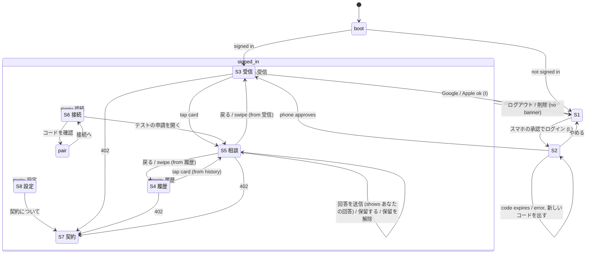

# Approval Box Web client: screen-transition map

> **Closed on 2026-11-21 (Owner decision).** The browser client no longer shows requests: the server must not hand request contents to a browser screen. Only two things remain in `packages/web/src/main.tsx`: the closed notice (`ブラウザ版は終わりました`, with links to `/support.html`, `/terms.html`, `/privacy.html`) on every path except `/pair`, and `/pair`, the consent page BellTeam's registered-client pairing needs (`docs/bellteam-client.md`): sign in (phone approval) if needed, then the pairing page, with no menu and no event stream. The closed notice calls no API. Everything else below (S3-S9, the menu, the routes) describes the retired client and is kept as history; it is not live.

Scope: `packages/web/src` only (a Preact single-page app). This map describes what the Web code does **after** it was brought to the common screens of `docs/architecture/screens.md` (the spec; state ids S1-S9 below are the spec's). Where the Web cannot follow the spec, section 9 says so and why.

- Labels are quoted as the ja-JP UI shows them. English and the other locales are in `packages/web/src/messages.ts` / `messages-east-asian.ts` (the Japanese text is the catalog key).
- Citations are `file` / function names relative to `packages/web/src/` (line numbers are not used, they drift); `server/` means `packages/server/src/`.
- Screenshots: `docs/screenshots/web/<state-id>-390.png` (390x844 phone width) and `-1280.png` (1280x800 desktop), ja-JP, generated by `tools/screens/capture-web.ts` against a stubbed API (section 10). The Google button is drawn by Google's own script and cannot be shown offline, so `login-id` shows a labelled stub box in its place.
- Where a claim comes from reading the server rather than the Web code, it says so.

## 1. Shell

- **No language picker at the top.** The picker (`言語`, drop-down `システムに合わせる` / `日本語` / `English` / `한국어` / `简体中文` / `繁體中文`, language.tsx) is on S1 (last line) and in S8 `言語`. Nowhere else.
- **Menu** (signed in only, main.tsx `Nav`): four links in this order: `受信` (with a count badge of pending requests), `履歴`, `接続`, `設定`. Phone width (< 720px): tab bar fixed to the bottom. Desktop: a bar at the top (style.css).
- **Page heading = menu label**: `受信`, `履歴`, `接続`, `設定` (the request screen S5 has the heading `相談`).
- **Highlight follows the page you came from.** `受信` is active on `/` and on `/d/...` opened from 受信; `履歴` on `/history` and on `/d/...` opened from 履歴 (the origin travels in `history.state.from`, router.ts `navigate`/`linkProps`/`listPath`); `接続` on `/connections` and `/pair`; `設定` on `/settings` and `/plan`. An unknown path shows the inbox with `受信` not highlighted.
- Browser tab title: `(n) Approval Box` when n requests are pending.
- Error alert (S9, dialog.tsx `AlertHost`/`showAlert`): a modal with title `確認してください`, the message, and `閉じる`. It replaces the browser's untitled `alert()`. Native `confirm`/`prompt` remain for destructive actions (deleting history, removing a connection, deleting the account).

## 2. Routes (main.tsx `App`)

| URL | Screen | Needs sign-in |
|---|---|---|
| `/` (and any unknown path) | S3 受信 | yes |
| `/d/<id>` | S5 相談 | yes |
| `/history` | S4 履歴 | yes |
| `/connections` | S6 接続 | yes |
| `/pair?c=<code>` | pairing confirm (part of S6) | yes |
| `/plan` | S7 契約 | yes |
| `/settings` | S8 設定 | yes |
| `/login` | rewritten to `/` (retired bookmark) | - |

When signed out, every URL shows S1 at the same URL; after signing in you stay on the URL you were on. Signing out navigates to `/`.

## 3. Which sign-in mode the server uses

`GET /v1/auth/config` decides:

- `library_login: true`: **phone-approval login** (the mode production uses). The pass is an HttpOnly cookie; the Web never sends `Authorization`. The signed-in check at boot is `GET /me`.
- otherwise: **ID login** with Google and/or Apple (kept working; same S1 structure, no phone-approval button because the server has no such login). Session token in `localStorage` key `approval-box.session`.

Both modes share one S1 (login.tsx `Login`). Differences are marked L (phone approval) or I (ID login).

## 4. States

"Shell" = menu (signed in) as in section 1.

### Signed out

**boot** `-` main.tsx. An empty page until `/auth/config` (and in L mode `GET /me`) answers. Shots: [390](screenshots/web/boot-390.png) [1280](screenshots/web/boot-1280.png)

**S1 `ログイン`** (L) login.tsx `Login`. In order: `Approval Box`; `AIの相談に、スマホやPCから答えます。`; the main button `スマホの承認でログイン` (nothing starts until it is pressed); disclosure `はじめての方へ` with the three steps (step 1 store sign-in and subscribe; step 2 `PCでコマンドを実行して、AIとつなぎます。` + `npx -y approval-box@latest setup` + `コマンドをコピー`; step 3 the other-device path); links `利用規約` (`/terms.html`) `プライバシーポリシー` (`/privacy.html`) `サポート` (`/support.html`); the language picker. Shots: [390](screenshots/web/login-library-390.png) [1280](screenshots/web/login-library-1280.png); disclosure open: [390](screenshots/web/login-library-first-time-390.png) [1280](screenshots/web/login-library-first-time-1280.png)

**S1** (I; Google and/or Apple configured) same structure with Google's button and `Appleでサインイン` (Apple's own button text) in place of the phone-approval button, the note `GoogleとAppleは別のアカウントになります。いつも同じ方でログインしてください。`, the disclosure with steps 1-2 only (step 3 names a button that does not exist in this mode), links, language picker. Shots: `login-id` [390](screenshots/web/login-id-390.png) [1280](screenshots/web/login-id-1280.png); Apple failure `Appleのログインができませんでした。`: `login-id-apple-error` [390](screenshots/web/login-id-apple-error-390.png) [1280](screenshots/web/login-id-apple-error-1280.png); no provider configured (the note `このサーバーにはログインの設定がありません。…`): `login-none` [390](screenshots/web/login-none-390.png) [1280](screenshots/web/login-none-1280.png)

**S1b** banner on S1, only after a signed-in browser got a 401 (a first visit shows no banner). The text follows the library error code of the 401 (api.ts `errorBody` -> `onUnauthorized(code)` -> login.tsx `Reason`):
- `pass_refused` (stopped from the phone, or "stop all other devices"): `この端末のログインは、承認したスマホから止められました。もう一度ログインしてください。` [390](screenshots/web/login-library-banner-stopped-390.png) [1280](screenshots/web/login-library-banner-stopped-1280.png)
- `pass_expired` (14 days unused): `しばらく使われなかったため、ログインが切れました。もう一度ログインしてください。` [390](screenshots/web/login-library-banner-expired-390.png) [1280](screenshots/web/login-library-banner-expired-1280.png)
- any other 401 (`pass_invalid`, an ID-login session that ended, account deleted elsewhere): `ログインが切れました。もう一度ログインしてください。` [390](screenshots/web/login-library-banner-other-390.png) [1280](screenshots/web/login-library-banner-other-1280.png)
(Source of the codes: the library's `errors.ts` in `@kitepon/login-billing`; `server/http.ts` lets `pass_invalid` fall through to the old session check and returns the others as they are. The Web does not invent a distinction the code does not carry.)

**S2 `スマホの承認を待っています`** (L) librarylogin.tsx `LibraryLogin`. QR (accessible name `QRコード`); `ログインコード` `ABCD-2345`; `確認番号` `42`; `HH:MMまで有効` (from the code's `expiresAt`, 24-hour); the guidance `契約したスマホの決裁箱で、設定 → ほかの端末をログインさせる を開き、このQRを読むか、コードを入力してください。確認番号が同じなら「許可する」を押します。`; button `やめる`. Shots: `login-library-wait` [390](screenshots/web/login-library-wait-390.png) [1280](screenshots/web/login-library-wait-1280.png)
- Code expired (`slot_gone`): stays on S2 with red `コードの期限が切れました。` and button `新しいコードを出す` (only `やめる` stays; the dead QR, the code and the guidance are removed). `login-library-expired` [390](screenshots/web/login-library-expired-390.png) [1280](screenshots/web/login-library-expired-1280.png)
- Code could not be issued / other error: red `コードを出せませんでした。通信を確かめてください。` and the same button. `login-library-error` [390](screenshots/web/login-library-error-390.png) [1280](screenshots/web/login-library-error-1280.png)

### Signed in

**S3 `受信`** `/` pages/Inbox.tsx. Shell; `h1` `受信`; chips `すべて` `未回答` `保留` (default `すべて`; pending first, held after); search field `相談を検索` (client-side, on title and `申請者 / 作業名`); one card per request: client chip, requester + work name, age, title, tags (`急ぎ`, deadline, `保留中`, `修正あり`, `テスト`). Nothing pending: `いま決めることはありません` / `相談が届いたら、お知らせします。`. Search with no hit: `この条件の相談はありません`. Each card carries its status word as the first tag: `未回答` or `保留`. A card opens S5. Shots: `inbox` [390](screenshots/web/inbox-390.png) [1280](screenshots/web/inbox-1280.png); `inbox-held` (chip `保留`) [390](screenshots/web/inbox-held-390.png) [1280](screenshots/web/inbox-held-1280.png); `inbox-search-none` [390](screenshots/web/inbox-search-none-390.png) [1280](screenshots/web/inbox-search-none-1280.png); `inbox-empty` [390](screenshots/web/inbox-empty-390.png) [1280](screenshots/web/inbox-empty-1280.png)

**S4 `履歴`** `/history` pages/History.tsx. `h1` `履歴`; chips `すべて` `回答済み` `取り下げ`; search `相談を検索`; cards (date, title, then the tags `回答済み` + the chosen option or `文で回答` + a delivery tag, or `取り下げ` + the reason). No match for a chip or search: `この条件の相談はありません`. Empty: `まだ履歴はありません` / `あなたの回答が、ここに残ります。`. Cards open S5 with `from: history`. **No delete button here**; deleting history is only in S8. Shots: `history` [390](screenshots/web/history-390.png) [1280](screenshots/web/history-1280.png); `history-empty` [390](screenshots/web/history-empty-390.png) [1280](screenshots/web/history-empty-1280.png)

**S5 `相談`** `/d/<id>` pages/DecisionView.tsx. Shell (highlight per section 1); `戻る`; client chip, requester / work, age; `h1` `相談`; the title as an `h2` (same size as the old title); tags (urgency, deadline, `テスト`, `接続: <name>`, the id); optional boxes `AIが修正しました` and `似た申請と別件である理由`; `背景` + the context; `AIの添付画像`. Answerable (pending or held), in this order: `どう進める？` (options as radio buttons, `AIの推奨` badge on the recommendation; nothing is preselected); `補足・別の指示`; one button `画像・書類を添付` (opens the browser's file picker; the attached files are listed above it; the hint `最大10件・1件20MB・合計50MB` below); then one row with `保留する` / `保留を解除` and `回答を送信` (enabled once an option is chosen, or text or an attachment is present). Answered: `あなたの回答` (option label or text, attachments), the delivery state (`AIへの配送待ち` / `AIへ届いた` / `届いたか不明` / `AIが受け取った`, with the explanation for unknown), and `再開の一言をコピー`. Cancelled: `AIが取り下げました` + reason. A collapsed `履歴` (timeline) is at the bottom. Banners (grey, above the chip): `AIがこの申請を取り下げました。`, `AIが内容を直しました。内容を確かめてから答えてください。`, or the server's message when hold/answer fails.
Shots: `decision-open` [390](screenshots/web/decision-open-390.png) [1280](screenshots/web/decision-open-1280.png); option chosen [390](screenshots/web/decision-open-chosen-390.png) [1280](screenshots/web/decision-open-chosen-1280.png); amended [390](screenshots/web/decision-open-amended-390.png) [1280](screenshots/web/decision-open-amended-1280.png); held [390](screenshots/web/decision-held-390.png) [1280](screenshots/web/decision-held-1280.png); answered [390](screenshots/web/decision-answered-390.png) [1280](screenshots/web/decision-answered-1280.png); answered, delivery unknown [390](screenshots/web/decision-answered-unknown-390.png) [1280](screenshots/web/decision-answered-unknown-1280.png); cancelled [390](screenshots/web/decision-cancelled-390.png) [1280](screenshots/web/decision-cancelled-1280.png); load error (red message + `受信一覧へ`) [390](screenshots/web/decision-error-390.png) [1280](screenshots/web/decision-error-1280.png)

**S6 `接続`** `/connections` pages/Connections.tsx. `h1` `接続`; sections in the spec's order:
1. `AIをつなぐ`: the PC command with `コマンドをコピー`; `PCでコマンドを実行すると、8文字のコードとQRが出ます。そのコードを下の欄に入れるか、QRを読みます。` (before the command); field `ABCD-EFGH` + `コードを確認` (-> `/pair?c=`). No `QRコードを読む` (section 9).
2. `つないだAI`: one row per connection (name, OS, last seen) with `外す` (native confirm). Empty: `まだつないだAIはありません。`
3. `接続テスト`: per device `テストする` (shows the hint to tell the AI `Approval Boxのsetup_testを実行して`) and the state line per AI client (`未テスト` / `答え待ち` / `AIへ配送中` / `確認済み` / `失敗` with the reason). When a check is `答え待ち` and the server gave its request id, `接続テストの申請を開く` opens S5 directly. Empty: `AIをつなぐと、ここでテストできます。`
4. `AIごとの登録手順`: one block per AI (Claude Code, Codex, Cursor, Grok) with its title and steps, taken from the server's `GET /onboarding` (the same endpoint, hence the same texts, the Android app uses; the server picks the language from `Accept-Language`). A step that has a command to copy gets the button `登録手順をコピー` (copies the command; `コピーしました` for 2s). Source: Connections.tsx `Guides`.
5. `画面のない端末を登録` (disclosure): a name field + `トークンを作る` (`POST /tokens`); the command with the token is shown once with `コマンドをコピー`. The new connection then appears under `つないだAI`.
Shots: `connections-empty` [390](screenshots/web/connections-empty-390.png) [1280](screenshots/web/connections-empty-1280.png); `connections` [390](screenshots/web/connections-390.png) [1280](screenshots/web/connections-1280.png); test hint [390](screenshots/web/connections-test-hint-390.png) [1280](screenshots/web/connections-test-hint-1280.png); token [390](screenshots/web/connections-token-390.png) [1280](screenshots/web/connections-token-1280.png)

**pair** `/pair?c=<code>` (the confirmation of S6). Own device: `h1` `AIをつなぐ`, `このAIをつなぎますか？`, name / OS / AI list, `つなぐ` / `心当たりがない`. Registered app (BellTeam): `h1` `アプリの接続を許可`, `許可する` / `許可しない`. After either: a notice and `接続へ`. Lookup failure: red server message, no button (leave via the menu). Shots: `pair-device` [390](screenshots/web/pair-device-390.png) [1280](screenshots/web/pair-device-1280.png); `pair-client` [390](screenshots/web/pair-client-390.png) [1280](screenshots/web/pair-client-1280.png); `pair-done` [390](screenshots/web/pair-done-390.png) [1280](screenshots/web/pair-done-1280.png); `pair-error` [390](screenshots/web/pair-error-390.png) [1280](screenshots/web/pair-error-1280.png)

**S7 `契約`** `/plan` pages/Plan.tsx. Opened from S8 `契約について`, and shown **in place of** S3, S4 and the S5 request when the API answers 402 (`subscription_expired` / `no_entitlement`). Content, in order:
1. The status line from `GET /me` (format.ts `planStatus`): `契約中（App Store）` / `契約中（Google Play）` / `未契約` / `期限切れ（YYYY/MM/DD）`; when active also `期限: YYYY/MM/DD`. A self-hosted server (`billing: off`) shows `このサーバーは自分で立てたもので、料金はかかりません。` and nothing else of the billing text.
2. The "cannot buy here" block, always on the Web: `この端末では契約できません。契約は、iPhone・iPad・Mac または Android の決裁箱で、設定 → 契約 から行います。` When active in L mode, also `この端末は、契約しているスマホの承認でログインしています。` There is no buy, restore or manage control.
3. `1か月ごとの自動更新。解約は、契約したストアの管理画面から行えます。` and links `利用規約` `プライバシーポリシー` `特定商取引法に基づく表記` (the last is `https://kitepon.dev/specified-commercial-transactions/#approval-box`).
4. `ログアウト`, only when not active.
Shots: no contract (also what `/`, `/history` and a request show on 402) `inbox-402` [390](screenshots/web/inbox-402-390.png) [1280](screenshots/web/inbox-402-1280.png), `history-402` [390](screenshots/web/history-402-390.png) [1280](screenshots/web/history-402-1280.png), `decision-402` [390](screenshots/web/decision-402-390.png) [1280](screenshots/web/decision-402-1280.png); `/plan` active (App Store) [390](screenshots/web/plan-subscribed-390.png) [1280](screenshots/web/plan-subscribed-1280.png); active (Google Play) [390](screenshots/web/plan-google-play-390.png) [1280](screenshots/web/plan-google-play-1280.png); expired [390](screenshots/web/plan-expired-390.png) [1280](screenshots/web/plan-expired-1280.png); none [390](screenshots/web/plan-none-390.png) [1280](screenshots/web/plan-none-1280.png); self-hosted [390](screenshots/web/plan-selfhost-390.png) [1280](screenshots/web/plan-selfhost-1280.png)

**S8 `設定`** `/settings` pages/Settings.tsx. `h1` `設定`; panels in the spec's order:
1. `アカウント`: `スマホの承認でログインしています` (L) / `Appleでログインしています` / `Googleでログインしています` (I).
2. `契約`: the status line (same as S7), `期限: YYYY/MM/DD` when active (same as S7), + `契約について` -> S7.
3. `ほかの端末`: `この端末は、ほかの端末をログインさせられません。止めるときは、承認したスマホの 設定 → ほかの端末 から止めます。` (the Web never has a store pass).
4. `通知`: `ブラウザ版には通知がありません。通知はスマホとPCのアプリで受け取れます。`
5. `言語`: the picker.
6. `履歴の保存`: `保存期間` (7 / 30 / 90 / 365 days, saves at once), `履歴を削除` (confirm, then `N件消しました。` on the page).
7. `ヘルプ`: `使い方・お問い合わせ` (`/support.html`), `利用規約`, `プライバシーポリシー`, nothing else. The Linux app note and the GitHub download link are on the support page (`/support.html`, ja and en, section `Linux版アプリ` / `Linux app`).
8. `アカウント管理`: `保存されている情報の写しを受け取る`, `ログアウト`, `アカウントと全データを削除`.
Shots: `settings-subscribed` (I, App Store) [390](screenshots/web/settings-subscribed-390.png) [1280](screenshots/web/settings-subscribed-1280.png); expired [390](screenshots/web/settings-expired-390.png) [1280](screenshots/web/settings-expired-1280.png); no contract (L) [390](screenshots/web/settings-no-contract-390.png) [1280](screenshots/web/settings-no-contract-1280.png); self-hosted [390](screenshots/web/settings-selfhost-390.png) [1280](screenshots/web/settings-selfhost-1280.png); L, Google Play [390](screenshots/web/settings-library-390.png) [1280](screenshots/web/settings-library-1280.png); a failed `履歴を削除` showing S9 [390](screenshots/web/settings-alert-390.png) [1280](screenshots/web/settings-alert-1280.png)

**S9** `確認してください` alert, dialog.tsx: raised by failed actions in S6 and S8 (settings save, history delete, export, connection removal, token creation, sign-out failure, account delete). Inline errors (list load failures, login errors, pairing lookup) stay in the page as red text.

Native dialogs (cannot be screenshotted): confirm `答え済みの履歴を全部消します。未決は残ります。よろしいですか？` (S8); confirm `アカウントと全データ（未決も含む）を削除します。元に戻せません。よろしいですか？` then prompt `確認のため「削除」と入力してください` (S8); confirm before `外す` (S6).

## 5. Transition table

All rows were checked by `tools/screens/capture-web.ts` or `packages/web/test/browser/*.spec.ts` unless marked "code only".

### 5.1 Start-up and sign-in

| From | Operation / trigger | To | Source |
|---|---|---|---|
| (page load) | auto | boot | main.tsx |
| boot | auto, L, `GET /me` ok | S3 (or the URL typed) | main.tsx |
| boot | auto, L, `GET /me` fails (401, network, 5xx) | S1 (no banner: nothing was signed in) | main.tsx `authRef` |
| boot | auto, I, session in localStorage | the URL typed (no server check; a bad session shows up as a 401 and S1b) | main.tsx |
| boot | auto, I, no session | S1 (I) | main.tsx |
| boot | `/auth/config` request fails | S1 (I) with the no-login note (cached for the page life) | idlogin.tsx `loginConfig` |
| S1 (L) | `スマホの承認でログイン` | S2 (the code is issued now, not before) | login.tsx |
| S1 (L) | `はじめての方へ` | opens in place | login.tsx |
| S1 | a link | `/terms.html` `/privacy.html` `/support.html` (new tab) | login.tsx |
| S1 | language picker | same screen, relabelled | language.tsx |
| S2 | the phone approves (`handoff/take` returns ready) | S3 (stays on the typed URL) | librarylogin.tsx |
| S2 | `やめる` | S1 | librarylogin.tsx |
| S2 | the code expires (410 `slot_gone`) | S2 with `コードの期限が切れました。` | librarylogin.tsx |
| S2 | other error | S2 with `コードを出せませんでした。…` | librarylogin.tsx |
| S2 (expired / error) | `新しいコードを出す` | S2 (new code) | librarylogin.tsx |
| S1 (I) | Google's button -> `POST /auth/google` ok | S3 | idlogin.tsx |
| S1 (I) | `Appleでサインイン` -> pop-up -> `POST /auth/apple` ok | S3 | idlogin.tsx |
| S1 (I) | Apple pop-up fails | S1 with the red `Appleのログインができませんでした。` | idlogin.tsx |

### 5.2 Menu and links (signed in)

| From | Operation | To | Source |
|---|---|---|---|
| any | menu `受信` / `履歴` / `接続` / `設定` | `/` `/history` `/connections` `/settings` | main.tsx `Nav` |
| S3 | a card | S5 (`from` unset, `受信` highlighted) | Inbox.tsx |
| S4 | a card | S5 with `from: history` (`履歴` highlighted) | History.tsx |
| S5 | `戻る` | browser back, or the origin list if there is no history | DecisionView.tsx, router.ts `listPath` |
| S5 (touch) | horizontal swipe 80px+ | the origin list (`/` or `/history`) | DecisionView.tsx |
| S5 | choose an option, `回答を送信` | stays on the same request, now showing `あなたの回答` | DecisionView.tsx `act` |
| S5 | `保留する` / `保留を解除` | stays; flips | DecisionView.tsx |
| S5 | `再開の一言をコピー` (answered) | stays; button reads `コピーしました` for 2s | DecisionView.tsx |
| S5 error | `受信一覧へ` | S3 | DecisionView.tsx |
| S6 | code + `コードを確認` | pair `/pair?c=<code>` (empty field: nothing) | Connections.tsx |
| S6 | `テストする` | same screen, hint shown | Connections.tsx |
| S6 | `接続テストの申請を開く` (check is `答え待ち` with a request id) | S5 of that request (works without a contract; code only: the id comes from the server) | Connections.tsx `checkLine` |
| S6 | `外す` | native confirm; yes -> row removed, same screen | Connections.tsx |
| S6 | `画面のない端末を登録` -> `トークンを作る` | same screen, command shown once | Connections.tsx `Tokens` |
| pair | `つなぐ` / `許可する`, `心当たりがない` / `許可しない` | pair-done | Connections.tsx `Pair` |
| pair-done | `接続へ` | S6 | Connections.tsx |
| S8 | `契約について` | S7 `/plan` | Settings.tsx |
| S8 | retention drop-down | saves; stays | Settings.tsx |
| S8 | `履歴を削除` | confirm; yes -> deleted, `N件消しました。`, stays | Settings.tsx |
| S8 | `保存されている情報の写しを受け取る` | downloads `approval-box-export-<date>.json`; stays | Settings.tsx, api.ts |
| S8 | `ログアウト` (L) | library `signOut`, then S1 at `/` (no banner) | account.ts `logout` |
| S8 | `ログアウト` (I) | `POST /auth/logout` (failure ignored), session cleared, S1 at `/` | account.ts `logout` |
| S8 | `アカウントと全データを削除` | confirm, type `削除`, `DELETE /me`; (L) also `signOut`; then S1 at `/` | Settings.tsx |
| S8 | `ヘルプ` links, GitHub download | external / static pages (new tab) | Settings.tsx |
| S7 | `ログアウト` (not active only) | S1 at `/` | Plan.tsx, account.ts |
| S7 | `特定商取引法に基づく表記`, `利用規約`, `プライバシーポリシー` | external / static pages (new tab) | Plan.tsx |
| any | `/login` | URL rewritten to `/` | main.tsx |
| any | unknown path | S3, nothing highlighted | main.tsx |

### 5.3 Automatic transitions

| From | Trigger | To | Source |
|---|---|---|---|
| any signed-in screen | any API call or the event stream answers 401 | S1 with the S1b banner for the code (`pass_refused` / `pass_expired` / other) | api.ts, main.tsx |
| (note) | the Web notices on its next call: when the tab becomes visible again, on a server event, or on your next click | - | main.tsx |
| S3 / S4 / S5 | the request answers 402 (`GET /decisions...`, `GET /decisions/<id>`, or the answer) | S7 in place (URL unchanged; the menu still works) | store.ts `useResource`, Inbox.tsx, History.tsx, DecisionView.tsx |
| S6 / S8 | 402 | none: `/me`, `/me/settings`, `/connections`, `/tokens`, `/pairing/*` are not behind the contract gate (read from `server/http.ts`), so these screens work without a contract | server/http.ts |
| event stream | answers 402 | the stream stops (no retry loop); the tab becoming visible again tries once more | api.ts `subscribeEvents`, main.tsx |
| event stream | drops for another reason | retries with growing delay (1s up to 60s) | api.ts |
| S5 (open) | the AI cancels or amends it | banner (SSE) | DecisionView.tsx |
| S3 | the AI sends a new request | the list refreshes; tab title count changes | main.tsx, store.ts |

## 6. What shows or hides

| Condition | What the Web does | Source |
|---|---|---|
| Signed out | only S1/S2 (the menu does not exist; every URL shows S1) | main.tsx |
| Signed in by phone approval (L) | `アカウント`: `スマホの承認でログインしています`; sign out = library sign-out | Settings.tsx |
| Signed in by Google/Apple (I) | `アカウント`: `Googleでログインしています` / `Appleでログインしています` | Settings.tsx |
| Pass stopped from the phone / expired | next call 401 -> S1 + S1b banner | api.ts, login.tsx |
| No contract (402) | S3, S4 and S5 show S7; S6, S8, export, sign-out and account deletion keep working. Exception on the server: a test request opened by id passes the gate, so the `接続テストの申請を開く` link works | server/http.ts |
| Contract expired / none (L) | status `未契約` (the store of a lapsed pass is unknown, so `期限切れ` appears only when `GET /me` has `expires_at`) | format.ts, server/accounts.ts |
| Contract active | `契約中（App Store）` / `契約中（Google Play）` / `契約中` (no store known) + `期限:` (S7 and S8) | format.ts |
| Self-hosted (`billing: off`) | the free sentence in S7 and S8; no cannot-buy block | format.ts, Plan.tsx |

Where things live:

- **Purchase**: not on the Web. S7 says so and tells where to subscribe.
- **Sign-out**: S8 `アカウント管理`, and S7 when not active.
- **Account deletion / export**: S8 `アカウント管理`.
- **History deletion**: S8 `履歴の保存` only.
- **Terms / privacy / support**: on S1, in S8 `ヘルプ` and in S7 (`/terms.html`, `/privacy.html`, `/support.html`, served from `packages/web/public`).
- **Language**: S1 and S8 `言語`.

## 7. State diagram



(The menu edges apply from every signed-in state, including S7 in place of a list.)

## 8. Labels and additions

Section 9 lists what the Web leaves out. Nothing in the spec was relabelled: every label, heading and guidance text is the spec's. The Web adds only a few lines the spec does not list: `AIをつなぐと、ここでテストできます。` (the empty `接続テスト` section) and the self-hosted sentence in S7/S8.

## 9. Not on the Web, and why

| Spec item | Web | Why |
|---|---|---|
| S1 native button `Appleでサインイン` / `Googleでログイン` | present only in ID-login mode | the contract: a Web browser is logged in by a phone's approval (L); the ID buttons exist only for servers without the library login |
| S2 `QRコードを読む` / camera (S6 and S8 where a camera exists) | not provided | the Web has no QR scanner; the code field is always there |
| S6 `接続テスト` creating the test request | the AI creates it (`setup_test`); the Web shows the hint and, when the server reports a request id, opens it | no API creates a test request from the user's side |
| S7 buy block, `購入を復元`, `…で契約を管理` | never shown | the Web cannot buy (contract section 3); the cannot-buy block is shown instead |
| S8 `ほかの端末` controls (`ほかの端末をログインさせる`, `ログインさせた端末`, `停止`) | explanatory text only | the Web never has a store pass, so it cannot approve or stop other devices |
| S8 `通知` | the section exists but only says there are no notifications in the browser | the Web has no notification setting (the spec's wording) |
| Native confirmations in S8 | native `confirm` / `prompt` | unchanged behaviour; the texts are the shared ones |

## 10. How the shots were made

```
npm ci                                    # once; the worktree used the main checkout's node_modules
PLAYWRIGHT_CHROMIUM_EXECUTABLE_PATH=<chromium> node tools/screens/capture-web.ts [state-id ...]
```

The script starts Vite on 127.0.0.1:4179, opens each state in a ja-JP context at 390x844 and 1280x800, and stubs `/v1/**` and `/auth/v1/**` the way `packages/web/test/browser/*.spec.ts` do. Requests to any other host are aborted; the Google and Apple sign-in scripts are replaced by local stubs. At 390px the viewport is grown to the page height so the fixed bottom menu stays at the bottom. With no state id it also runs the transition checks (21 of them: S1 -> S2 -> inbox, やめる, code expiry, the three S1b banners, 402 -> S7 with sign-out and the stopped event stream, 契約について, answering and staying on the request, the 履歴 highlight and 戻る, nav, pairing, tokens, sign-out, account deletion, history deletion, export, unknown path); one line each, exit code 1 on any failure.

What cannot be reached without a real phone or live server, and what is shown instead:
- A real phone approval and a real pass stop: the stub answers `handoff/take` with `ready` and later a `401` with `pass_refused` / `pass_expired` / `pass_invalid`; the screens are real, the approval is simulated.
- Google's button, Apple's pop-up: stubbed (`login-id`, `login-id-apple-error`).
- AI-attached images, attachment upload and the native dialogs: not captured.
- The 402 text and the status line come from the stub's `GET /me`; on a real server the same fields (`plan`, `store`, `expires_at`) drive them.
