# Approval Box Web client: screen-transition map

Scope: `packages/web/src` only (a Preact single-page app), as of origin/main `8159725`. Nothing here is a proposal; it describes what the code does today.
The native apps are mapped separately. This is a factual map for a later redesign.

- On-screen labels are quoted as the ja-JP UI shows them. The English label follows in parentheses (`en:`) where the en locale differs (catalog: `packages/web/src/messages.ts`; Japanese is the key, so ja text is the source string in the `t("...")` call).
- Citations are `file:line` relative to `packages/web/src/` unless they start with `server/` (= `packages/server/src/`).
- Screenshots: `docs/screenshots/web/<state-id>-390.png` (390x844 phone width) and `-1280.png` (1280x800 desktop), ja-JP. They are generated by `tools/screens/capture-web.ts` against a stubbed API (see "How the shots were made" at the end). The Google sign-in button is drawn by Google's own script and cannot be shown offline, so `login-id` shows a clearly labelled stub box in its place.
- Where a claim comes from reading the server rather than from the Web code, it says so.

## 1. Shell that is on every screen

- Language picker, top right of every screen including the blank boot screen: label `言語` (en: Language), a drop-down with `システムに合わせる` (en: Use system language), `日本語`, `English`, `한국어`, `简体中文`, `繁體中文` (main.tsx:57-63, 90-91, 103). It is not in Settings.
- Menu (only when signed in), main.tsx:40-55, 104. Four links in this order: `受信` (en: Inbox, with a red count badge of pending decisions), `既決` (en: Completed), `接続` (en: Connections), `設定` (en: Settings). Phone width (< 720px): a tab bar fixed to the bottom of the screen. Desktop: a bar under the language picker (style.css:53-65).
- Browser tab title is `(n) Approval Box` when n pending decisions exist, else `Approval Box` (main.tsx:43).
- The menu has no sign-out, no billing item, no help. Those are inside 設定.

Menu highlight rules (main.tsx:49-52): `受信` is active on `/` and every `/d/...`; `既決` on `/history`; `接続` on `/connections` and `/pair`; `設定` on `/settings`. On any other path nothing is active.

## 2. Routes (main.tsx:89-99)

| URL | Screen | Needs sign-in |
|---|---|---|
| `/` (and any unknown path) | inbox | yes |
| `/d/<id>` | decision | yes |
| `/history` | completed list | yes |
| `/connections` | connections | yes |
| `/pair?c=<code>` | pairing confirm | yes |
| `/settings` | settings | yes |
| `/login` | rewritten to `/` with `history.replaceState` (retired bookmark), then behaves as `/` | - |

When signed out, every URL shows the sign-in screen at that same URL; after signing in you land on the URL you were on (main.tsx:90-93). Signing out from 設定 navigates to `/` (main.tsx:98).

## 3. Which sign-in mode the server uses

`GET /v1/auth/config` decides (main.tsx:71-78, server/http.ts:180-181):

- `library_login: true`: **phone-approval login** (QR code / short code, approved in the phone app). The pass is an HttpOnly cookie; the Web never sends an `Authorization` header (api.ts:13-17, 43). Signed-in check at boot is `GET /me` (main.tsx:76).
- otherwise: **ID login** with Google and/or Apple (only the providers the server lists). Session token in `localStorage` key `approval-box.session` (api.ts:4-11).

The screens below are labelled L (library/phone approval) or I (ID login) where they differ. Which mode the live server answers I could not check (no contact with live servers was allowed).

## 4. States

Format: id, URL, content in on-screen order. "Shell" = language picker (+ menu when signed in) as in section 1.

### Signed out

**boot** (L and I) `-` main.tsx:90. Shell with language picker only; nothing else. Shown from page load until `/auth/config` (and in L mode `GET /me`) answers. Shots: [390](screenshots/web/boot-390.png) [1280](screenshots/web/boot-1280.png)

**login-id** (I; Google and Apple both configured) main.tsx:16-28, idlogin.tsx:61-71. Heading `Approval Box`; text `AIが判断を求める時に、ここへ集まります。答えはその場でAIの会話へ届きます。` (en: Requests for your decision arrive here. Your answers go back to the AI conversation.); Google's own button (drawn by Google's script, idlogin.tsx:40-46, 67); button `Appleでログイン` (en: Sign in with Apple) (idlogin.tsx:68); note `GoogleとAppleは別のアカウントになります。いつも同じ方でログインしてください。` (en: Google and Apple create separate accounts. Always use the same sign-in method.) (main.tsx:24). Only the configured provider(s) appear. Shots: [390](screenshots/web/login-id-390.png) [1280](screenshots/web/login-id-1280.png)

**login-id-apple-error** (I) idlogin.tsx:48-58, 69. Same as login-id, plus red `Appleのログインができませんでした。` (en: Could not sign in with Apple.) under the buttons. Other red messages in the same place: `Googleのログインを読み込めませんでした。` (Could not load Google sign-in.) (idlogin.tsx:45), `ログインできませんでした。` (Could not sign in.) or the server's message (idlogin.tsx:38). Closing Apple's pop-up produces no message (idlogin.tsx:56). Shots: [390](screenshots/web/login-id-apple-error-390.png) [1280](screenshots/web/login-id-apple-error-1280.png)

**login-none** (I; neither provider configured, or `/auth/config` failed) main.tsx:25. Heading and tagline only, then `このサーバーにはログインの設定がありません。管理者は、AppleかGoogleのログインを設定してください（READMEの「自分でサーバーを立てる」）。` (en: Sign-in is not configured on this server. Ask the administrator to configure Apple or Google sign-in (see self-hosting in the README).). No button; dead end. Shots: [390](screenshots/web/login-none-390.png) [1280](screenshots/web/login-none-1280.png)

**login-library-loading** (L) main.tsx:30-38, librarylogin.tsx:35-45. Heading `Approval Box` and the tagline only, until the code is issued (`POST /auth/v1/handoff/start`). Shots: [390](screenshots/web/login-library-loading-390.png) [1280](screenshots/web/login-library-loading-1280.png)

**login-library** (L) librarylogin.tsx:37-44. Heading, tagline, then: QR code image (accessible name `QRコード`, en: QR code); small grey `コード` (en: Code); the short code as `ABCD-2345`; `スマホの決裁箱アプリで読み取るか、コードを入力してください。表示される番号が 42 か確かめてください。` (en: Scan the QR code with the Approval Box app on your phone, or enter the code. Check that the number it shows is 42.); grey `契約がまだの方は、先にスマホで契約してください。` (en: If you have not subscribed yet, subscribe on your phone first.). No buttons. The page polls `handoff/take` until the phone approves (librarylogin.tsx:24). The device label sent is browser and OS only (devicelabel.ts). Shots: [390](screenshots/web/login-library-390.png) [1280](screenshots/web/login-library-1280.png)

**login-library-expired** (L) librarylogin.tsx:29, 46-51. Heading, tagline, red `コードの有効期限が切れました。` (en: The code has expired.), button `新しいコードを出す` (en: Get a new code). Shots: [390](screenshots/web/login-library-expired-390.png) [1280](screenshots/web/login-library-expired-1280.png)

**login-library-error** (L) same lines. Red `コードを出せませんでした。通信を確かめてください。` (en: Could not get a code. Check your connection.), same button `新しいコードを出す`. Also reached on any non-`slot_gone` error while waiting. Shots: [390](screenshots/web/login-library-error-390.png) [1280](screenshots/web/login-library-error-1280.png)

### Signed in

**inbox** `/` pages/Inbox.tsx:28-51. Shell; `h1` `Approval Box` (note: the menu item is `受信`, the heading is not); one card per pending decision, then, if any are held, `h2` `保留中` (en: On hold) and their cards. A card (Inbox.tsx:8-26) shows: client chip (Claude Code / Codex / Cursor / Grok / Claude / ChatGPT / `その他` (Other)), requester in bold + work name, age (`9 分前`), title, tags: `急ぎ` (Urgent) if urgent, a deadline text, `保留中` (On hold), `修正あり` (Updated), `テスト` (Test). The whole card is a link to `/d/<id>`. Shots: [390](screenshots/web/inbox-390.png) [1280](screenshots/web/inbox-1280.png)

**inbox-empty** Inbox.tsx:37-42. `いま答えを待っている申請はありません。` (en: No requests are waiting for an answer.) and grey `AIが判断を求めると、ここに届きます。` (en: Requests appear here when your AI needs a decision.). Shots: [390](screenshots/web/inbox-empty-390.png) [1280](screenshots/web/inbox-empty-1280.png)

**inbox-402** (no contract, L mode) Inbox.tsx:35, api.ts:33. Shell, `h1` `Approval Box`, red `iPhone・Mac・Android のアプリで契約してください` (en: Subscribe in the iPhone, Mac or Android app). No link, no button, no list. Menu stays usable; the pending-count badge is absent (the menu's own fetch failed too). Also while loading: grey `読み込み中…` (en: Loading…). Shots: [390](screenshots/web/inbox-402-390.png) [1280](screenshots/web/inbox-402-1280.png)

**decision-open** `/d/<id>`, status pending, pages/DecisionView.tsx. Shell; `‹ 戻る` (en: ‹ Back) (142); client chip, requester / work, age; `h1` the decision title (148); tags: urgency (`急ぎ` / `通常` / `低`; en: Urgent / Normal / Low), deadline, `テスト`, `接続: <device name>` (en: Connection:), the decision id such as `K-A1B2C3`; optional boxes `AIが修正しました` (en: Updated by AI) + changed field names (157) and `似た申請と別件である理由` (en: Why this is a separate request) (162); context text with links; optional `AIの添付画像` (en: Images from AI); then the answer area (166-201): one button per option (the recommended one carries `AIの推奨`, en: AI recommendation; pressing any option sends the answer at once); `添え書き・別の指示（任意）` (en: Comment or other instructions (optional)) text box with placeholder `選択肢を選ばずに、文だけで指示し直すこともできます` (en: You can reply with instructions without choosing an option); `添付（画像・書類、10ファイル・合計50MBまで。任意）` (en: Attachments (images or documents, up to 10 files and 50 MB total; optional)) with button-like `ファイルを追加` (en: Add files); primary button `文だけで答える` (en: Send text; disabled until text or attachment exists; becomes `添付だけで答える` Send attachments or `文と添付で答える` Send text and attachments, line 194) and `保留にする` (en: Put on hold) (198); then `再開の一言をコピー` (en: Copy resume phrase) (215); a collapsed `履歴` (en: History) list (217-). Touch only: a horizontal swipe of 80px or more on the page goes to the inbox (92-141). Shots: [390](screenshots/web/decision-open-390.png) [1280](screenshots/web/decision-open-1280.png)

**decision-open-amended** (same screen, last history entry is an AI amendment) boxes `AIが修正しました（背景・選択肢）` with the AI's note, and `似た申請と別件である理由`. Shots: [390](screenshots/web/decision-open-amended-390.png) [1280](screenshots/web/decision-open-amended-1280.png)

**decision-held** status held, line 197. As decision-open but the second button reads `保留を戻す` (en: Resume request). Shots: [390](screenshots/web/decision-held-390.png) [1280](screenshots/web/decision-held-1280.png)

**decision-answered** lines 203-212. No answer area. Block: `答え:` (en: Answer:) + the chosen option label (or `（文で回答）` (Text answer) / `（添付で回答）` (Attachment answer)), the typed text, attachments, and a delivery line: `AIへの配送待ち` (Waiting for delivery to AI) / `AIへ届いた` (Delivered to AI) / `届いたか不明` (Delivery unconfirmed) / `AIが受け取った` (Received by AI) (format.ts:7). Still has `再開の一言をコピー` and `履歴`. Shots: [390](screenshots/web/decision-answered-390.png) [1280](screenshots/web/decision-answered-1280.png)

**decision-answered-unknown** line 209. As above with delivery `届いたか不明` and grey `AIへ届いたか確かめられませんでした。元の会話に下の一言を送ると、AIが答えを取りに来ます。` (en: Delivery could not be confirmed. Send the resume phrase below in the original conversation so the AI can retrieve your answer.). Also `チャットへ戻った時に、AIが答えを受け取ります。` (en: The AI will receive your answer when you return to the chat.) for waiting remote requests (210). Shots: [390](screenshots/web/decision-answered-unknown-390.png) [1280](screenshots/web/decision-answered-unknown-1280.png)

**decision-cancelled** line 213. `AIが取り下げました` (en: Cancelled by AI) and the reason. Shots: [390](screenshots/web/decision-cancelled-390.png) [1280](screenshots/web/decision-cancelled-1280.png)

**decision-error** line 59. No shell content except menu: red server message (e.g. `項目が見つかりません。`) and one button `受信一覧へ` (en: Back to inbox) -> `/`. Shots: [390](screenshots/web/decision-error-390.png) [1280](screenshots/web/decision-error-1280.png)

**decision-402** line 59 with the 402 text `iPhone・Mac・Android のアプリで契約してください` and the same single button `受信一覧へ`, which leads to inbox-402. Shots: [390](screenshots/web/decision-402-390.png) [1280](screenshots/web/decision-402-1280.png)

Banner states on the decision screen (a grey notice line above the client chip, lines 143, 47-52, 80): `AIがこの申請を取り下げました。` (en: The AI cancelled this request.), `AIが内容を直しました。内容を確かめてから答えてください。` (en: The AI updated this request. Review the changes before answering.), or the server's message when answer/hold fails (for example a 402 or a conflict). Not separately shot.

**history** `/history` pages/History.tsx. `h1` `既決` (en: Completed); one card per answered/cancelled decision (client chip, requester/work, date, title, tags: the chosen option label or `文で回答` (Text answer), a delivery tag, or `AIが取り下げ` (Cancelled by AI) + reason; `テスト`); each card links to `/d/<id>`; at the bottom a red `既決の履歴を削除` (en: Delete completed history). Shots: [390](screenshots/web/history-390.png) [1280](screenshots/web/history-1280.png)

**history-empty** History.tsx:26. grey `まだ答えた申請はありません。` (en: No completed requests yet.); no delete button. Shots: [390](screenshots/web/history-empty-390.png) [1280](screenshots/web/history-empty-1280.png)

**history-402** History.tsx:24. `h1` `既決` and the 402 text. Shots: [390](screenshots/web/history-402-390.png) [1280](screenshots/web/history-402-1280.png)

**connections-empty** `/connections` pages/Connections.tsx:44-95. `h1` `接続` (en: Connections); panel `端末を追加` (en: Add a device): code field (placeholder `ABCD-EFGH`) and primary `次へ` (en: Next), grey text `PCで次のコマンドを実行すると出るコードです。QRコードはスマホのカメラで読めます。` + the command `npx -y approval-box@latest setup`; when there are no connections the panel `はじめに: PCにコネクタを入れる` (en: First: install the connector on your computer) with the same command and a `コピー` (Copy) button, and `画面にQRコードとコードが出たら、下の「端末を追加」で読み取るか、コードを入力します。` (68, 23-31); panel `チャットのAI（Claude・ChatGPT）` (en: Chat AI (Claude and ChatGPT)) with `Claude.ai・ChatGPTのコネクタからの接続は準備中です。` (not available yet). Shots: [390](screenshots/web/connections-empty-390.png) [1280](screenshots/web/connections-empty-1280.png)

**connections** (with devices) Connections.tsx:70-88. After the add panel, one panel per connection: name (e.g. `開発PC`), OS and last-seen age, one line per AI client with its test state (`未テスト` Not tested / `答え待ち` Awaiting answer / `AIへ配送中` Delivering to AI / `確認済み` Verified / `失敗` Failed, with the date; a failed line adds an explanation such as `答えがAIへ届きませんでした。PCで approval-box doctor を実行して原因を確かめてください。`), buttons `接続テスト` (en: Test connection; not shown for registered-app connections such as BellTeam) and red `外す` (en: Remove). Shots: [390](screenshots/web/connections-390.png) [1280](screenshots/web/connections-1280.png)

**connections-test-hint** after `接続テスト` (line 80, 83-85). A notice in that panel: `テストしたいAIに次のように伝えてください。` **`Approval Boxのsetup_testを実行して`** `テストの申請に答えると、AIが受け取り、ここが「確認済み」になります。` (en: Answer the test request in your inbox. When the AI receives it, this page will show Verified.). Shots: [390](screenshots/web/connections-test-hint-390.png) [1280](screenshots/web/connections-test-hint-1280.png)

**pair-device** `/pair?c=<code>` Connections.tsx:98-150. `h1` `端末を追加`; `次の端末を、あなたのApproval Boxに追加しますか？` (en: Add this device to your Approval Box?); list `端末名` (Device name), `OS`, `使うAI` (AI clients); grey `自分で approval-box の setup を実行した覚えがなければ「心当たりがない」を押してください。`; primary `この端末を追加` (en: Add this device), red `心当たりがない` (en: I don't recognize this device). Shots: [390](screenshots/web/pair-device-390.png) [1280](screenshots/web/pair-device-1280.png)

**pair-client** same URL, registered app (for example BellTeam). `h1` `アプリの接続を許可` (en: Allow an app to connect); `BellTeamがあなたの決裁箱の申請を読み、あなたが押した答えを送ることを許可しますか？`; `接続元` (Connecting from); warning text; primary `許可する` (Allow), red `許可しない` (Don't allow). Shots: [390](screenshots/web/pair-client-390.png) [1280](screenshots/web/pair-client-1280.png)

**pair-done** after either button (line 112-115, 123). Notice `追加しました。PCの画面でセットアップが続きます。` / `断りました。この端末は追加されません。` / `許可しました。BellTeamの画面で接続が続きます。` / `許可しませんでした。BellTeamは接続されません。` and one button `接続へ` (en: Back to connections) -> `/connections`. Shots: [390](screenshots/web/pair-done-390.png) [1280](screenshots/web/pair-done-1280.png)

**pair-error** line 122. Heading `端末を追加` + red server message, e.g. `そのコードは見つからないか、期限が切れています。PCで npx -y approval-box@latest setup をやり直してください。`. No button; leave via the menu. Shots: [390](screenshots/web/pair-error-390.png) [1280](screenshots/web/pair-error-1280.png)

**settings** `/settings` pages/Settings.tsx:50-102. `h1` `設定` (en: Settings), then panels in this order:
1. `ログイン` (en: Sign-in) panel: `Googleでログインしています。` / `Appleでログインしています。` / `AppleでもGoogleでもないログインで使っています（廃止した入口）。` Shown only in ID mode (line 54).
2. `契約` (en: Subscription) panel (55-76). See the matrix in section 6.
3. `既決の保存` (en: History retention): label `答え済みの申請を自動で消すまでの日数` (Automatically delete completed requests after), a drop-down 7 / 30 / 90 / 365 日 (changes save at once), red `既決の履歴を削除` (Delete completed history).
4. `Linux版アプリ` (en: Linux app): text about the .deb and link `ダウンロード（GitHub）` (en: Download (GitHub)) (opens GitHub in a new tab).
5. `アカウント` (en: Account): `ログアウト` (Sign out), `保存されている情報の写しを受け取る` (Get a copy of the information we keep), red `アカウントと全データを削除` (Delete account and all data).
Shots (subscribed through App Store, ID mode): [390](screenshots/web/settings-subscribed-390.png) [1280](screenshots/web/settings-subscribed-1280.png)

Settings variants (only the subscription panel differs):

- **settings-subscribed**: `App Storeで契約中` (en: Subscribed through the App Store) / `Google Playで契約中` (Subscribed through Google Play) + `特定商取引法に基づく表記` link. Same shots as above; L mode: [settings-library](screenshots/web/settings-library-390.png) [1280](screenshots/web/settings-library-1280.png) (no `ログイン` panel).
- **settings-expired**: `期限切れ` (en: Expired) + `iPhone・Mac・Android のアプリで契約してください` + 特商法 link + a list of unverified checks `Codexはまだ確認できていません（失敗）` (only when setup is verified). Shots: [390](screenshots/web/settings-expired-390.png) [1280](screenshots/web/settings-expired-1280.png)
- **settings-unverified**: `未契約` (Not subscribed) (or the plan label) + a notice `契約の前に、セットアップ確認を済ませてください。答えがAIまで届くことを確かめてから契約できます。` with button `接続とテストへ` (en: Connections and tests) -> `/connections`; the subscribe-in-the-app sentence is not shown in this case; the 特商法 link still is. Shots: [390](screenshots/web/settings-unverified-390.png) [1280](screenshots/web/settings-unverified-1280.png)
- **settings-no-contract**: `未契約` + `iPhone・Mac・Android のアプリで契約してください` + 特商法 link (+ unverified-check list). Shots: [390](screenshots/web/settings-no-contract-390.png) [1280](screenshots/web/settings-no-contract-1280.png)
- **settings-selfhost** (`billing: off`): `このサーバーは自分で立てたもので、料金はかかりません。` (en: This is a self-hosted server. There is no subscription fee.) and nothing else in the panel (no 特商法 link). Shots: [390](screenshots/web/settings-selfhost-390.png) [1280](screenshots/web/settings-selfhost-1280.png)

Native dialogs raised from these screens (cannot be screenshotted, not part of the SPA): confirm `答え済みの履歴を全部消します。未決は残ります。よろしいですか？` (History.tsx:14, Settings.tsx:23); confirm `アカウントと全データ（未決も含む）を削除します。元に戻せません。よろしいですか？` then prompt `確認のため「削除」と入力してください` which must equal `削除` (en: type `DELETE`) (Settings.tsx:29-30); confirm `「<name>」の接続を外します。この端末のAIはApproval Boxを使えなくなります。` (or, for a registered app, `「<name>」の許可を外します。<name>はApproval Boxを読めなくなります。`) (Connections.tsx:51); alert with the error text on any failure; alert `<n>件消しました。` (en: Requests deleted: n.) after Settings' history delete (Settings.tsx:25).

## 5. Transition table

"Where" is on-screen position. Auto = no user operation. All rows were checked by `tools/screens/capture-web.ts` unless marked "code only".

### 5.1 Start-up and sign-in

| From | Operation / trigger | To | Source |
|---|---|---|---|
| (page load) | auto | boot | main.tsx:67, 90 |
| boot | auto, `/auth/config` has `library_login`, `GET /me` ok | inbox (or the URL typed) | main.tsx:73-76 |
| boot | auto, library, `GET /me` fails (any error: 401, network, 5xx) | login-library-loading -> login-library | main.tsx:76, 91 |
| boot | auto, not library, session in localStorage | the URL typed (no server check; a bad session shows up as a 401 on the first call) | main.tsx:75 |
| boot | auto, not library, no session | login-id or login-none | main.tsx:75, 91, 18, 24-25 |
| boot | auto, `/auth/config` request fails | treated as "not library" with no providers: login-none (error is cached for the page life) | idlogin.tsx:28, main.tsx:18, 25 |
| login-library | auto, phone approves (`handoff/take` returns ready) | inbox (stays on the typed URL) | librarylogin.tsx:24-25, main.tsx:91 |
| login-library | auto, code expires (410 `slot_gone`) | login-library-expired | librarylogin.tsx:29 |
| login-library | auto, other error | login-library-error | librarylogin.tsx:29 |
| login-library-expired / -error | button `新しいコードを出す` (below the red message) | login-library-loading -> login-library (new code) | librarylogin.tsx:49 |
| login-id | Google's own button (credential) -> `POST /auth/google` ok | inbox | idlogin.tsx:43, main.tsx:23 |
| login-id | button `Appleでログイン` -> pop-up -> `POST /auth/apple` ok | inbox | idlogin.tsx:48-54 |
| login-id | Apple pop-up fails | login-id-apple-error | idlogin.tsx:57 |

### 5.2 Menu and links (signed in)

| From | Operation | To | Source |
|---|---|---|---|
| any signed-in screen | menu `受信` | inbox `/` | main.tsx:49 |
| any | menu `既決` | history `/history` | main.tsx:50 |
| any | menu `接続` | connections `/connections` | main.tsx:51 |
| any | menu `設定` | settings `/settings` | main.tsx:52 |
| any | language picker `言語` | same screen, relabelled | main.tsx:57-63 |
| inbox | tap a card | decision `/d/<id>` | Inbox.tsx:11 |
| history | tap a card | decision `/d/<id>` (menu still highlights `受信`) | History.tsx:29, main.tsx:49 |
| decision | `‹ 戻る` (top left) | browser back, or `/` if no history | DecisionView.tsx:142 |
| decision (touch) | swipe horizontally 80px+ | inbox `/` | DecisionView.tsx:115-141 |
| decision | option button | (POST answer) -> inbox `/`; the answer cannot be undone from the Web | DecisionView.tsx:69-74, 169-173 |
| decision | `文だけで答える` etc. | same, -> inbox `/` | DecisionView.tsx:193 |
| decision | `保留にする` | stays; becomes decision-held | DecisionView.tsx:198 |
| decision-held | `保留を戻す` | stays; becomes decision-open | DecisionView.tsx:197 |
| decision | `再開の一言をコピー` | stays; button reads `コピーしました` for 2s | DecisionView.tsx:86-89, 215 |
| decision | `履歴` (summary) | expands in place | DecisionView.tsx:217 |
| decision-error / decision-402 | `受信一覧へ` | inbox (or inbox-402) | DecisionView.tsx:59 |
| connections | code field + `次へ` | pair `/pair?c=<code>` (empty field: nothing) | Connections.tsx:61 |
| connections | `接続テスト` | same screen, hint shown (connections-test-hint) | Connections.tsx:80, 83 |
| connections | `外す` | native confirm; yes -> device removed, same screen | Connections.tsx:50-54 |
| pair-device / pair-client | `この端末を追加` / `許可する` | pair-done (added/allowed) | Connections.tsx:107-115 |
| pair-device / pair-client | `心当たりがない` / `許可しない` | pair-done (rejected) | Connections.tsx:107-115 |
| pair-done | `接続へ` | connections | Connections.tsx:123 |
| (outside the Web) | QR code on the PC opened by a phone camera, or a link | `/pair?c=...` (the Web has no link to it other than the code field) | Connections.tsx:65 |
| settings | `接続とテストへ` (only when setup not verified) | connections | Settings.tsx:65 |
| settings | `特定商取引法に基づく表記` | external page (new tab), `kitepon.dev/specified-commercial-transactions/#approval-box` | Settings.tsx:10, 68 |
| settings | `ダウンロード（GitHub）` | external, GitHub releases (new tab) | Settings.tsx:91 |
| settings | retention drop-down | saves; stays | Settings.tsx:19-21, 81 |
| settings / history | `既決の履歴を削除` | confirm; yes -> list emptied; stays (Settings also alerts the count) | History.tsx:13-19, Settings.tsx:22-27 |
| settings | `保存されている情報の写しを受け取る` | downloads `approval-box-export-<date>.json`; stays | Settings.tsx:36-38, api.ts:104-118 |
| settings | `ログアウト` (L) | `signOut` on the library, then login-library at `/` | Settings.tsx:39-44, main.tsx:98 |
| settings | `ログアウト` (I) | `POST /auth/logout` (failure ignored), session cleared, login-id at `/` | Settings.tsx:45-47 |
| settings | `アカウントと全データを削除` | confirm, type `削除`, `DELETE /me`; (L) also `signOut`; then sign-in screen at `/` | Settings.tsx:28-35 |

### 5.3 Automatic transitions

| From | Trigger | To | Source |
|---|---|---|---|
| any signed-in screen | any API call or the event stream answers 401 (pass stopped from the phone, session expired, account deleted elsewhere) | sign-in screen (login-library, or login-id/login-none); URL kept; no message | api.ts:60, 68, 134; main.tsx:70 |
| (note) | the Web only notices on its next call: when the tab becomes visible again, on a server event, or on your next click. An already open event stream is not cut by the Web | - | main.tsx:79-87, api.ts:121-134 |
| inbox / history / decision | `/decisions...` answers 402 (library pass without a contract, server/http.ts:37, 261) | inbox-402 / history-402 / decision-402: red `iPhone・Mac・Android のアプリで契約してください`; menu still works; no sign-out | api.ts:33, Inbox.tsx:35, History.tsx:24, DecisionView.tsx:59 |
| decision | answer/hold gets 402 or a conflict | grey notice on the same screen (a conflict also refreshes the decision) | DecisionView.tsx:75-80 |
| connections / settings | 402 | none: `/me`, `/me/settings`, `/connections`, `/pairing/*` are not behind the contract gate (server/http.ts:37), so these screens work without a contract | server/http.ts:37, 261 |
| signed in, event stream | answers 402 (no contract) | retries with growing delay (1s up to 60s), forever; no screen change | api.ts:130-135, 158-159 |
| decision (open) | the AI cancels or amends it | banner `AIがこの申請を取り下げました。` / `AIが内容を直しました。…` (SSE bump) | DecisionView.tsx:43-57 |
| inbox | the AI sends a new decision | the list refreshes; tab title count changes | main.tsx:79-82, 43 |
| any | `/login` | URL rewritten to `/` | main.tsx:89 |
| any | unknown path | inbox, nothing highlighted in the menu | main.tsx:99 |

## 6. What shows or hides

| Condition | What the Web does | Source |
|---|---|---|
| Signed out | only sign-in (section 4); the menu does not exist; every URL shows sign-in | main.tsx:91 |
| Signed in by phone approval (L) | no `ログイン` panel in settings; sign out = library sign-out | Settings.tsx:54, 40 |
| Signed in by Google/Apple (I) | settings shows `Googleでログインしています。` / `Appleでログインしています。` | Settings.tsx:54 |
| Pass stopped from the phone | nothing is shown; the next API call returns 401 -> sign-in screen (L: a fresh QR). Web has no "you were signed out" message | api.ts:60, main.tsx:70 |
| No contract (L pass without entitlement) | `/decisions*` and the event stream answer 402: inbox, history, decision show the subscribe-in-the-app sentence. Connections, pairing, settings, export, sign-out, account deletion keep working. Exception on the server: reading/answering a test decision directly by id passes the gate, listing does not | server/http.ts:37-39, 261 |
| Contract expired (store known, plan expired) | settings: `期限切れ` + the subscribe sentence; screens that need the contract behave as in "No contract" when the server's pass says so | Settings.tsx:61, 67 |
| Contract expired / none in L mode | settings: `未契約` (the store is unknown for a lapsed pass, so `期限切れ` cannot appear) | Settings.tsx:61, server/accounts.ts:195-196 |
| Setup not verified | settings: `契約の前に、セットアップ確認を済ませてください。…` + `接続とテストへ`; the subscribe sentence and the unverified-check list are hidden in this case | Settings.tsx:62-67, 69 |
| Setup verified, some AI clients not passed | settings: list `<client>はまだ確認できていません（<state>）`; connections: per-client state | Settings.tsx:69-73, Connections.tsx:78 |
| Self-hosted (`billing: off`) | settings: `このサーバーは自分で立てたもので、料金はかかりません。`; no 特商法 link | Settings.tsx:58-59 |
| Contract active | settings shows the store (`App Storeで契約中` / `Google Playで契約中`), or `契約中` when no store is known | Settings.tsx:13-14, 61 |
| Pending test decision (setup) | an inbox card with tag `テスト` | Inbox.tsx:22 |

Where things live:

- **Purchase / billing**: not available on Web. There is no purchase button, price, store link or checkout anywhere in `packages/web/src`. The only words are the sentence `iPhone・Mac・Android のアプリで契約してください` (api.ts:33; shown as the 402 text and in 設定 > `契約`, Settings.tsx:67) and, on the QR login screen, `契約がまだの方は、先にスマホで契約してください。` (librarylogin.tsx:43). The only billing-related link is `特定商取引法に基づく表記` (Settings.tsx:68, hidden when billing is off).
- **Sign-out**: 設定 > `アカウント` > `ログアウト` (Settings.tsx:96). Nowhere else.
- **Account deletion**: 設定 > `アカウント` > `アカウントと全データを削除` (Settings.tsx:98).
- **Export**: 設定 > `アカウント` > `保存されている情報の写しを受け取る` (Settings.tsx:97).
- **History**: menu `既決` (`/history`); history delete also in 設定 > `既決の保存`.
- **Connections / devices**: menu `接続`; add via code field or `/pair?c=`. The test hint is behind `接続テスト` on a device panel.
- **Settings**: menu `設定`: retention, history delete, Linux app download, account actions. There is no language setting in it (the picker is on every screen) and no notification setting.
- **Terms / privacy / support**: the files `public/terms.html`, `privacy.html`, `support.html` exist but nothing in the SPA links to them; the catalog key `利用規約` (en: Terms of Service) is defined (messages.ts:47) and not used.

## 7. State diagram

State ids use underscores here; they match the hyphenated ids above.

```mermaid
stateDiagram-v2
  [*] --> boot
  boot --> inbox: signed in (L: GET /me ok; I: session in localStorage)
  boot --> login_library_loading: L, not signed in
  boot --> login_id: I, no session, provider configured
  boot --> login_none: I, no session, no provider / config failed

  login_library_loading --> login_library: code issued
  login_library_loading --> login_library_error: start failed
  login_library --> inbox: phone approves
  login_library --> login_library_expired: 410 slot_gone
  login_library --> login_library_error: other error
  login_library_expired --> login_library_loading: 新しいコードを出す
  login_library_error --> login_library_loading: 新しいコードを出す
  login_id --> inbox: Google / Apple ok
  login_id --> login_id_apple_error: Apple fails
  login_id_apple_error --> inbox: retry ok

  state signed_in {
    inbox --> decision: tap card
    history --> decision: tap card
    decision --> inbox: answer / swipe / 受信一覧へ
    decision --> decision: 保留にする / 保留を戻す
    decision --> decision_error: load fails
    inbox --> inbox_402: 402
    history --> history_402: 402
    decision --> decision_402: 402
    decision_402 --> inbox_402: 受信一覧へ
    connections --> pair: code + 次へ
    pair --> pair_done: add / allow / reject
    pair --> pair_error: lookup fails
    pair_done --> connections: 接続へ
    connections --> connections: 接続テスト (hint) / 外す
    settings --> connections: 接続とテストへ (setup not verified)
    settings --> settings: retention / export / history delete
  }
  signed_in --> inbox: menu 受信
  signed_in --> history: menu 既決
  signed_in --> connections: menu 接続
  signed_in --> settings: menu 設定
  signed_in --> login_library_loading: 401 (L) or ログアウト / 削除 (L)
  signed_in --> login_id: 401 (I) or ログアウト / 削除 (I)
```



(The menu edges apply from every signed-in state, including the 402 and error states. `login_id` becomes `login_none` when no provider is configured.)

## 8. Confusing points noticed (also summarised in the report)

1. Billing cannot be started from Web, and the only hint is one sentence with no link: api.ts:33, Settings.tsx:67, librarylogin.tsx:43. The sentence names iPhone, Mac and Android; the Linux app panel (Settings.tsx:88-91) and Web users get no way to pay and no mention.
2. Subscribe-first vs verify-first loop (read from the server, not exercised): 設定 tells you to verify setup before subscribing (Settings.tsx:63-65) and the test hint says to answer the test request "in your inbox" (Connections.tsx:84), but for a pass without a contract `GET /decisions` (the inbox list) is 402 (server/http.ts:37, 261); only opening `/d/<id>` directly is exempt (server/http.ts:39). Also server/accounts.ts:266 refuses the store purchase until setup is verified.
3. Two names for one place: menu `受信` but the page heading is `Approval Box` (Inbox.tsx:34); the button `接続とテストへ` (Settings.tsx:65) lands on a page titled `接続` (Connections.tsx:58) that has no section called テスト (only a per-device `接続テスト` button, Connections.tsx:80, which exists only when a device is registered).
4. `端末を追加` is both a panel on `接続` (Connections.tsx:60) and the heading of `/pair` (Connections.tsx:121); the pairing page heading changes to `アプリの接続を許可` for registered apps.
5. `既決の履歴を削除` exists twice with the same label and different feedback: History.tsx:47 (silent) and Settings.tsx:85 (alert with count).
6. Menu highlight and back: opening a completed decision from `既決` highlights `受信` (main.tsx:49); `‹ 戻る` is browser-back (DecisionView.tsx:142) while answering always jumps to `/` (DecisionView.tsx:74). Unknown URLs silently show the inbox with no menu item active (main.tsx:99); `/login` is rewritten during render (main.tsx:89).
7. Silent drop to sign-in: pass stopped from the phone, expiry and 401s show no message (api.ts:60, main.tsx:70). In L mode a network blip at boot also shows a QR screen (main.tsx:76), and a failed `/auth/config` is cached and shown as "sign-in is not configured on this server" (idlogin.tsx:28, main.tsx:25).
8. 402 dead end: the decision-402 screen's only button goes to the inbox, which shows the same text (DecisionView.tsx:59, Inbox.tsx:35). No heading `契約`, no link; the menu is the only way out. The event stream keeps retrying a 402 forever (api.ts:135, 158-159).
9. L mode: 設定 hides the `ログイン` panel (Settings.tsx:54), so a phone-approved browser has no screen telling how or on which account it is signed in, and the lapsed-contract label is always `未契約`, never `期限切れ` (Settings.tsx:61, server/accounts.ts:195-196).
10. Dead ends: login-none has no button (main.tsx:25); pair-error has no button (Connections.tsx:122); Connections ignores a failed load (Connections.tsx:46, 68, 70).
11. Legal pages are unreachable from the SPA: `利用規約` is defined and unused (messages.ts:47); `terms.html`, `privacy.html`, `support.html` have no link; 特商法 link appears only inside the billing panel (Settings.tsx:68).
12. Destructive actions share a row with 'ログアウト' and use native confirm/prompt dialogs (Settings.tsx:95-99, 23, 29-30); the language picker is on every screen but not in 設定 (main.tsx:57, 103).
13. A hidden touch-only gesture leaves the decision screen (DecisionView.tsx:92-141).
14. The `接続テスト` instruction asks you to speak to your AI (`Approval Boxのsetup_testを実行して`); nothing on the screen shows the test progress except the per-client state line after the AI acts (Connections.tsx:83-85, 38).

## 9. How the shots were made

```
npm ci                                    # once; the worktree used the main checkout's node_modules
PLAYWRIGHT_CHROMIUM_EXECUTABLE_PATH=<chromium> node tools/screens/capture-web.ts [state-id ...]
```

The script starts Vite on 127.0.0.1:4179, opens each state in a ja-JP context at 390x844 and 1280x800, and stubs `/v1/**` and `/auth/v1/**` the way `packages/web/test/browser/library-login.spec.ts` and `localization.spec.ts` do. Requests to any other host are aborted; the Google and Apple sign-in scripts are replaced by local stubs. At 390px the viewport is grown to the page height so the fixed bottom menu stays at the bottom. With no state id it also runs 12 transition checks (marked above) and exits 1 on any failure.

States that cannot be reached without a real phone or live server and what is shown instead:
- A real phone approval and a real pass stop: the stub answers `handoff/take` with `ready` and a later `401 pass_invalid`; the screens are real, the approval is simulated.
- Google's button, Apple's pop-up: stubbed (login-id, login-id-apple-error).
- The AI-attached images, attachment upload and the native dialogs (confirm/prompt/alert): not captured.
- Real 402 text from the server: the same Japanese sentence is hard-coded on the Web (api.ts:33), so the shot is exact.
